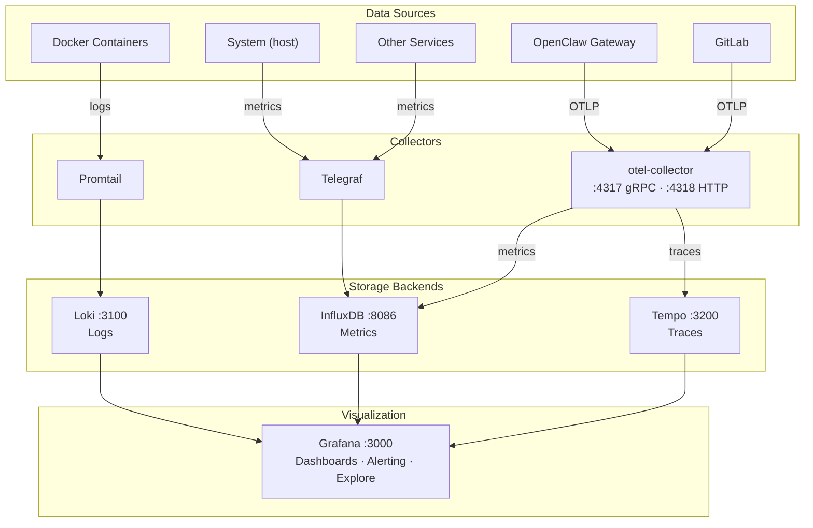

# Observability

The observability stack covers three pillars — **logs**, **metrics**, and **traces** — plus **alerting** via Grafana.

Grafana alerting runs on the router itself, so it cannot report the router (or its Docker disk) going down. An off-box heartbeat to healthchecks.io covers that: see [DEADMAN.md](DEADMAN.md).

Server hardware events from the BMC (SEL entries, PSU, fan and temperature status) are exported in-band by `ipmi-metrics.timer` and alerted on by the `bmc-*` rules: see [IPMI.md](IPMI.md).

## Architecture



## Signal Routing

| Signal  | Source             | Collector         | Backend    | Query Language |
|---------|--------------------|-------------------|------------|----------------|
| Logs    | Docker containers  | Promtail          | Loki       | LogQL          |
| Metrics | System, services   | Telegraf           | InfluxDB   | Flux           |
| Metrics | OTLP-instrumented  | otel-collector     | InfluxDB   | Flux           |
| Traces  | OTLP-instrumented  | otel-collector     | Tempo      | TraceQL        |

## Components

### Logs: Promtail → Loki

**Promtail** discovers Docker containers and tails their logs, then ships them to **Loki**.

- Config: `docker/promtail/config.yml` (router), `docker/promtail/satellite-config.yml` (satellites)
- All containers use the default `json-file` log driver. On the router, Promtail's `docker` job finds
  containers with `docker_sd_configs` and reads their logs through the read-only Docker API proxy
  (`docker-socket-proxy-ro`), not the Docker socket
- Loki config: `docker/loki/local-config.yaml`
- Query via Grafana Explore with LogQL

#### Dropped lines

Some containers emit high-volume lines that carry no information. Promtail drops
them in the `docker` job's `pipeline_stages` before they reach Loki. Each rule
sets a `drop_counter_reason`, so what was discarded is still countable via
promtail's `promtail_dropped_lines_total` metric.

| Reason | Container | What it drops | Measured volume |
|--------|-----------|---------------|-----------------|
| `gitlab_tail_banner`      | gitlab | `==> /var/log/gitlab/<file> <==` banners from omnibus `tail -F` | 11.5k/hr (2026-09-11) |
| `gitlab_blank_line`       | gitlab | blank lines from the same `tail -F` | 11.4k/hr (2026-09-11) |
| `gitlab_otel_cache_attr`  | gitlab | `OpenTelemetry error: invalid span attribute value type ... for key 'cache.super_operation'` (LabKit bug, see [GitLab tracing](#gitlab-tracing-labkit)) | ~14k/hr from an idle Sidekiq (canary, 2026-11-08) |
| `loki_compaction_chatter` | loki   | `index_set.go` / `tables_manager.go` info lines | 160k/day (2026-09-20) |
| `loki_listed_files`       | loki   | `table.go` `msg="listed files"` info lines | 33k/day (2026-09-20) |
| `loki_owned_streams`      | loki   | `recalculate owned streams` info lines | 5.8k/day (2026-09-20) |

The `loki_*` rules are anchored on `level=info`, so a warn or error from the same
caller still ships. Before adding a rule here, measure the line's share of total
ingest rather than guessing: `sum(count_over_time({job=~".+"}[24h]))` is the
denominator.

### Metrics: Telegraf → InfluxDB

**Telegraf** collects system and service metrics via plugins and writes to **InfluxDB v2**.

- Config: `docker/telegraf/telegraf.conf`
- Satellite config: `docker/telegraf/satellite-telegraf.conf` (on zwave it also
  reads the miniDSP units, measurement `minidsp`; see `docs/minidsp.md`)
- Org: `homelab`, Bucket: `metrics`
- ~117 input plugin instances covering Docker, system, SNMP, services, etc.
- Query via Grafana dashboards with Flux

### Traces + OTLP Metrics: otel-collector → Tempo / InfluxDB

The **OpenTelemetry Collector** (contrib distribution) receives OTLP data and routes it:

- **Traces** → Tempo (via OTLP/gRPC)
- **Metrics** → InfluxDB (via native InfluxDB exporter)
- **Logs** → debug exporter (stdout, for troubleshooting)
- **Span counts** → InfluxDB: the `count` connector counts every span it
  receives by resource `service.name` (measurement `otelcol_spans_by_service`,
  field `gauge` = spans in that batch, tag `service.name`; all other resource
  attributes are stripped so a Puma worker's pid is not a tag). The
  *Trace Emitter Silent* alert reads it.

Config: `docker/otel-collector/config.yaml`

#### Instrumented Services

| Service   | Method                           | Signals          |
|-----------|----------------------------------|------------------|
| OpenClaw  | Native `diagnostics-otel` plugin | Traces + Metrics |
| GitLab    | LabKit, `GITLAB_TRACING` in `gitlab.rb` (below) | Traces, 1% sampled |
| Grafana   | Built-in OTel support            | Traces           |

Each of these is an *expected emitter*: the `trace-emitter-silent` alert
fires when one sends no spans for its window (2h; openclaw-gateway 12h,
because it only emits when it has work). In May 2026 openclaw-gateway stopped
exporting and nobody noticed for weeks; the collector-down alerts do not catch
one service going quiet. A new emitter goes into the rule's `expected` rows
and name filter.

#### GitLab tracing (LabKit)

GitLab traces through LabKit (the `gitlab-labkit` gem), configured by one
variable in `gitlab_rails['env']` (`docker/gitlab/gitlab.rb`), which omnibus
writes to `/opt/gitlab/etc/gitlab-rails/env` for Puma, Sidekiq,
`gitlab-rails` and `gitlab-rake`:

```
GITLAB_TRACING=otlp://otel-collector:4318/v1/traces?service_name=gitlab&sampler=probabilistic&sampler_param=0.01
```

- LabKit reads only `GITLAB_TRACING`. The `OTEL_EXPORTER_OTLP_ENDPOINT` /
  `OTEL_SERVICE_NAME` / `GITLAB_ENABLE_OTEL_EXPORTERS` variables that used to
  be set did nothing (GitLab's own OTel initializer only runs in dev, test and
  staging), which is why GitLab never sent a span before #106.
- The `/v1/traces` path is required: LabKit posts to the URL as written.
- `sampler=probabilistic&sampler_param=0.01` is a TraceIdRatioBased sampler,
  1% of traces. Even GitLab's quietest hours (~700 requests/h) give several
  traces an hour.

**Workaround, and when to remove it.** With `GITLAB_TRACING` set, LabKit
(5.5 in GitLab 19.5.x, unchanged up to LabKit 5.8) installs the OpenTelemetry
ActionMailer instrumentation. Its railtie calls
`OpenTelemetry::Instrumentation::ActiveSupport`, which nothing requires, so
Rails dies at boot with `NameError: uninitialized constant
OpenTelemetry::Instrumentation::ActiveSupport`. Reconfigure (`gitlab:db:configure`),
Puma and Sidekiq all crash-loop; that was the 2026-11-07 outage (!1041,
[CANARY.md](CANARY.md)). `gitlab.rb` therefore also sets

```
OTEL_RUBY_INSTRUMENTATION_ACTIONMAILER_ENABLED=false
```

which the OpenTelemetry instrumentation base honours: ActionMailer is never
installed, so its railtie is never loaded. The name is the instrumentation
class path upcased, `ACTIONMAILER` with no underscore
(`..._ACTION_MAILER_...` is silently ignored). Cost: no spans for outgoing
mail. Preloading the ActiveSupport instrumentation instead is not possible
from `gitlab.rb`: the Puma and Sidekiq run scripts hard-code `RUBYOPT`, and
the `gitlab-rails`/`gitlab-rake` wrappers unset it.

Remove the variable once a GitLab release loads the instrumentation itself
(LabKit's `auto_initialize.rb` requiring `opentelemetry/instrumentation/active_support`,
or the action_mailer railtie requiring it). To check on an upgrade: delete the
line in the Renovate MR (or a branch off it) and let the `canary` job run. If
it passes, including its "tracing reaches the collector" check, the workaround
is no longer needed.

A second upstream bug is only noise: LabKit's `cache_read` span sets
`cache.super_operation` to a Symbol or nil, and the SDK logs an
`OpenTelemetry error: invalid span attribute value type ...` line per span
(~230/min from an idle Sidekiq). Promtail drops those lines
(`gitlab_otel_cache_attr`, above); the attribute is just missing from the span.

### Alerting: Grafana

Grafana evaluates alert rules against all three backends and routes notifications.

- Alert rules: `docker/grafana/provisioning/alerting/infrastructure.yml`, plus
  `anomaly.yml` for the anomaly detector (`docker/anomaly-detector/README.md`)
- Rule groups in `infrastructure.yml`: container, system, network, certificate,
  hardware, backup, security, log-volume, document-pipeline, datasource-health,
  trace-emitter and radio-silence alerts. Among them:
  - memory: *Container Memory Near Limit (85%+)*, *Container OOM Kill*,
    *Kernel OOM Kill*, *High Memory Usage (90%+)*
  - disks: *Disk Temperature High* (over 50C HDD / 65C SSD for 15 min),
    *Disk Vanished* (a disk stops reporting SMART data while the host's other
    disks still report), *ZFS Pool Unhealthy* (a pool not ONLINE),
    *ZFS Pool Health Collection Failed*
  - traces: *Trace Emitter Silent* (an expected emitter, see Instrumented
    Services, sent no spans in its window; not a page)
  - radios: *Zigbee Radio Silence* (zigbee2mqtt hears no device for ~20 min)
    and *Z-Wave Radio Silence* (no Z-Wave JS value update for 15 min)
- Contact points: `docker/grafana/provisioning/alerting/contactpoints.yml.j2`
- Notification policies: `docker/grafana/provisioning/alerting/policies.yml`

## Configuration Reference

| Component       | Config File                                    | Port(s)          |
|-----------------|------------------------------------------------|------------------|
| Grafana         | Env vars in `docker-compose.yml`               | 3000             |
| Loki            | `docker/loki/local-config.yaml`                | 3100             |
| Tempo           | `docker/tempo/tempo.yaml`                      | 3200, 4317, 4318 |
| InfluxDB        | Env vars in `docker-compose.yml`               | 8086             |
| Telegraf        | `docker/telegraf/telegraf.conf`                 | —                |
| Promtail        | `docker/promtail/config.yml`                   | —                |
| otel-collector  | `docker/otel-collector/config.yaml`            | 4317, 4318       |

## Adding Instrumentation

### OTLP traces (any service)

Set these environment variables in the service's compose definition:

```yaml
environment:
  - OTEL_EXPORTER_OTLP_ENDPOINT=http://otel-collector:4318
  - OTEL_EXPORTER_OTLP_PROTOCOL=http/protobuf
  - OTEL_SERVICE_NAME=your-service-name
  - OTEL_TRACES_EXPORTER=otlp
```

The service must include an OTel SDK or auto-instrumentation library. This works out of the box for:
- **Node.js** — `@opentelemetry/auto-instrumentations-node`
- **Python** — `opentelemetry-distro`
- **Ruby** — `opentelemetry-sdk` (GitLab bundles it but is configured through LabKit, see GitLab tracing above)
- **Go** — manual SDK integration required

### OpenClaw native plugin

OpenClaw has built-in OTLP export via `diagnostics-otel`. Configured in `openclaw.json.j2`:

```json
{
  "diagnostics": {
    "enabled": true,
    "otel": {
      "enabled": true,
      "endpoint": "http://otel-collector:4318",
      "serviceName": "openclaw-gateway",
      "traces": true,
      "metrics": true
    }
  },
  "plugins": {
    "allow": ["diagnostics-otel"],
    "entries": {
      "diagnostics-otel": { "enabled": true }
    }
  }
}
```

See: https://docs.openclaw.ai/logging#export-to-opentelemetry

### Telegraf metrics (non-OTLP)

Add input plugins to `docker/telegraf/telegraf.conf`. Output is pre-configured for InfluxDB.
