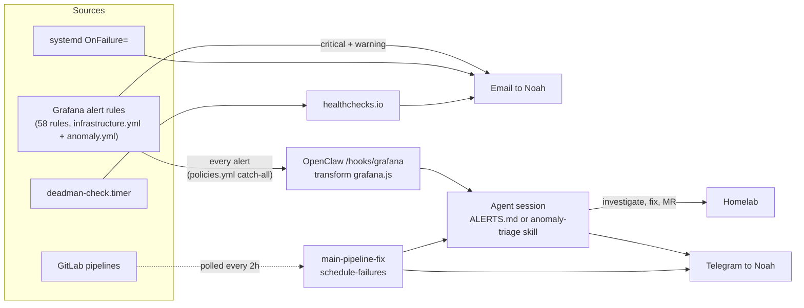
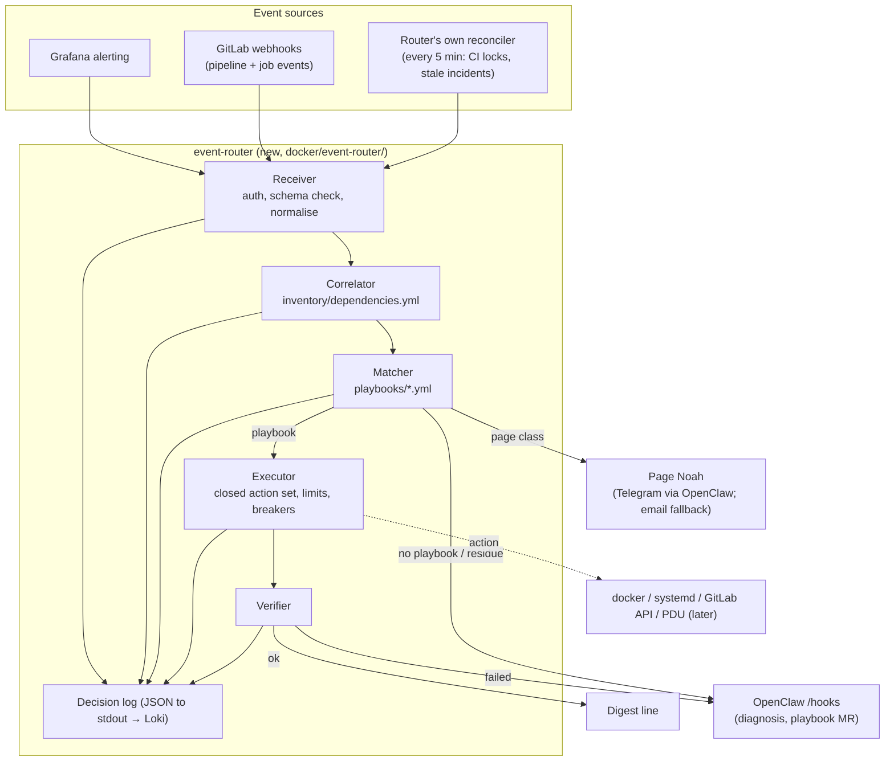
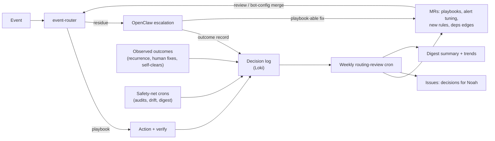

# Event Routing: Deterministic First Responder, Agent Behind It — Design Document

> **Status:** Accepted (decisions in section 11); phases 1–2 being implemented
> **Author:** Claude (on Noah's direction)
> **Date:** 2026-11-07
> **Stakeholder:** Noah Kontur
> **Related:** [OBSERVABILITY.md](../OBSERVABILITY.md), [AUTOMERGE.md](../AUTOMERGE.md), [DEADMAN.md](../DEADMAN.md), [jit-access-design.md](../jit-access-design.md), `inventory/dependencies.yml`, `docker/anomaly-detector/README.md`

---

## Summary

Today every Grafana alert goes to two places at once: the OpenClaw agent (an
LLM session that investigates, maybe fixes, and messages Noah on Telegram) and,
for every `critical`/`warning` rule, Noah's inbox. CI failures reach the agent
only through two-hourly polling crons. That arrangement is slow where speed
matters (a stalled Zigbee coordinator went unnoticed for about an hour on
2026-11-07), noisy where it does not (Noah gets an email *and* an agent message
for an alert the agent then fixes), and it leans on the agent for work whose
fix is already known and written down.

This document proposes an **event router**: a small, deterministic service in
this repo that receives Grafana and GitLab webhooks, correlates them against
the dependency graph in `inventory/dependencies.yml`, and runs **playbooks**
(match, then one allowlisted action, then verification, then escalation) for
the cases where the fix is known. The OpenClaw agent moves behind it and
handles what code cannot: diagnosis when no playbook matches or a playbook
fails, turning each new incident's fix into a playbook MR, and the slow loop
(audits, drift, trends). The existing polling crons stay as a slower
reconciliation net, Kubernetes-style: edge-triggered events for speed,
level-triggered resync for correctness.

**Recommendation in brief**

1. Build `docker/event-router/` as a standalone service (not an OpenClaw hook transform), so first response works when OpenClaw, the Claude API or GitLab is down.
2. Playbooks are YAML data in the repo, CODEOWNERS-protected, with a closed action set, per-playbook rate limits and circuit breakers, and no free-form input from event text.
3. Correlate through `inventory/dependencies.yml` so one root cause is one incident (MQTT down suppresses Zigbee silence).
4. Noah is paged only for security, data at risk, failed remediation and the always-notify classes (UPS, platform); everything else goes to a digest or the monthly decision queue.
5. Learn from every incident: OpenClaw files a structured outcome for each escalation and turns playbook-able fixes into MRs; a weekly routing review tunes noisy alerts, fixes or retires weak playbooks and flags missed incidents (section 8).
6. Roll out in shadow mode first, then three playbooks (Zigbee silence, orphaned CI job, crash-loop restart-once), then reroute residue to OpenClaw and slow down the polling crons, then PDU playbooks once the PDU exists.

---

## 1. Problem statement

### 1.1 Current state



**Grafana alerting** (`docker/grafana/provisioning/alerting/`):

- `policies.yml`: the root receiver is `openclaw-webhook`; the first child route
  is a zigbee2mqtt log-flood exception (agent only, `continue: false`); the
  second child route matches `severity =~ ".*"` and sends **every** alert to
  `openclaw-webhook` (`group_wait 30s`, `group_interval 10m`,
  `repeat_interval 24h`, `continue: true`). Further routes send
  `critical|warning` (and `HighMemory`/`DiskSpace` names) to
  `homelab-email-alerts` (`group_wait 10s`, `group_interval 2m`,
  `repeat_interval 24h`). Grouping is by `alertname, severity`.
- `contactpoints.yml.j2`: `openclaw-webhook` POSTs to the gateway's
  `/hooks/grafana` with a bearer token from Vault; `homelab-email-alerts`
  emails Noah. Both send resolve notifications.
- `infrastructure.yml`: 56 rules in groups for containers, system, network,
  certificates, hardware (SMART, ZFS, UPS, BMC), backups (restic, DB dumps),
  security (failed SSH logins, Vault sealed), log volume, document pipeline,
  datasource health, and the radio-silence rules added on 2026-11-07
  (`zigbee-radio-silence`, `zwave-radio-silence`).
- `anomaly.yml`: `anomaly-severe` (only severe, unsuppressed detector output,
  `severity: critical`, `source: anomaly-detector`) and
  `anomaly-detector-down`.

**OpenClaw hooks** (`docker/openclaw/openclaw.json.j2`, `hooks` section):
hooks enabled at path `/hooks`, transforms from
`/home/node/.openclaw/hooks/transforms`, one mapping `grafana` with
`action: agent`, `deliver: true` to Telegram, transform
`docker/openclaw/hooks/transforms/grafana.js`. The transform turns the alert
payload into a prompt:

- all alerts from `source=anomaly-detector`, firing: follow
  `skills/anomaly-triage/SKILL.md` (check the detector's `/status`, recent
  deploys and `/context`; message Noah only if actionable, otherwise
  `NO_REPLY`);
- the same, resolved: `NO_REPLY`;
- anything else: "Read ALERTS.md ... Fix if possible. Notify Noah via
  Telegram with what happened and what you did."

`ALERTS.md` (in the agent workspace) tells the agent to assess, investigate in
Loki and Grafana via JIT tier-1 tokens, fix (restart a container through
elevated JIT SSH, or open an MR), and **always** notify Noah. Every alert is
therefore a fresh LLM session with broad tools, and a Telegram message.

**Anomaly detector** (`docker/anomaly-detector/`): fixed rules over InfluxDB
(seasonal, rate, stale, drift, threshold checks; `config.yml` signals in
categories `gone_quiet`, `physical`, `infrastructure`, `pattern`;
`suppressions.yml` with mandatory expiry). Severe anomalies raise
`Anomaly: severe` (agent triage + email); moderate ones go only to the 08:00
`anomaly-digest`, the dashboard and Home Assistant.

**OpenClaw crons** (19 as of 2026-11-07, `openclaw cron list` in
`openclaw-gateway`):

| Cron | Schedule (America/New_York) | Purpose | Infra-relevant |
|---|---|---|---|
| `main-pipeline-fix` | `0 */2 * * *` | Newest finished push pipeline on `main`; if newly failed (and not an auto-merge `deploy-service` rollback), spawn a fix sub-agent that opens an MR; announces to Telegram | Yes |
| `schedule-failures` | `10 */2 * * *` | Shell script, no LLM: one Telegram message per GitLab schedule with new failed pipelines (projects 4 and 14) | Yes |
| `MR Health Check` | `0 3 * * *` | Rebase/fix moltbot's own open MRs; list stale MRs for Noah | Yes |
| `image-update-check` | `30 3 * * *` | Breaking-change research for major image updates (Renovate opens the MRs) | Yes |
| `Infrastructure Audit` | `0 4 * * *` | Repo review plus Grafana/Loki/Influx/Tempo analysis; improvement MRs | Yes |
| `advisory-watch` | `30 6 * * *` | Read vendor advisories for deployed products; write requests to an outbox | Yes |
| `anomaly-digest` | `0 8 * * *` | 24h anomaly digest from the detector | Yes |
| `Morning Digest` | `0 9 * * *` | Email, restic/DB-dump status, overnight red-team findings, MRs/issues, cron health, personal sections | Partly |
| `nightly-redteam` | `0 1 * * *` | Read-only internal configuration review, writes a report | Yes (separate track) |
| `cron-config-sync` | `0 */6 * * *` | Export cron definitions to the agent's memory repo | Agent housekeeping |
| `skill-review` | `0 2 * * 3` | Review skill feedback, update skills | Agent housekeeping |
| `fact-extraction` | `0 6 * * *` | Agent memory | Agent housekeeping |
| `weekly-knowledge-synthesis` | `0 10 * * 0` | Agent memory | Agent housekeeping |
| `nightly-meditation` | `0 23 * * *` | Agent reflection | Agent housekeeping |
| `email-check` | `0 9,13,17 * * *` | Personal email | Out of scope |
| `imessage-check` | every 30 min | Personal messaging / media requests | Out of scope |
| `job-scout`, `job-apply`, `job-retry-nightly` | `0 2`, `*/30`, `0 3` | Personal | Out of scope |

**Other automation that already acts on events:**

| Mechanism | Where | What it does |
|---|---|---|
| Auto-merge sweep | `ci/automerge/`, [AUTOMERGE.md](../AUTOMERGE.md); schedule every 15 min | Merges eligible image updates, per-service deploy, health gate (`wait-healthy.sh`), automatic rollback with an `automerge-rollback` issue and revert MR; per-service holds while a rollback issue is open |
| Drift jobs | `.gitlab-ci.yml`: `facts:drift` (`ci/facts/drift.py`), `aruba-s2500:drift`, `netgear:drift`, `aruba-iap:drift`, `ups-card:drift`, `ipmi:drift`, `denon:drift` | Daily comparison of live state with the repo; open/update an issue or mail; fail the job. Work in progress (`facts/drift-autoresolve`) classifies drift so it can resolve itself: software drift is redeployed, an explainable physical change becomes a data MR, anything needing hands goes to a monthly queue |
| Dead-man's switch | `ansible/roles/deadman`, [DEADMAN.md](../DEADMAN.md) | Router pings healthchecks.io every 5 min; missing or failed pings alert off-box |
| Docker restart policies | `docker/docker-compose*.yml` | 73 services `restart: unless-stopped`; 68 healthchecks in the router compose file. Docker restarts crashed processes but never restarts an *unhealthy* one |
| systemd | `snapclient/snapclient.service` (`Restart=on-failure`); restic, DB-dump and Frigate-backup units (`OnFailure=restic-notify-failure@%n`) | Process restart; failure mail |
| JIT approval service | `docker/jit-approval-svc/` | Tier 1 auto-approved (Grafana, InfluxDB, media apps, ...); short-lived GitLab tokens for the agent auto-approved since 2026-11-07; tier 2/3 approval by Noah on Telegram |
| Deploy locks | `resource_group: deploy-router` and friends in `.gitlab-ci.yml` | Serialise deploys per host/device; a stuck job holds the group |

### 1.2 What went wrong on 2026-11-07

These incidents are the worked examples used throughout.

| # | Incident | How it was found | What fixed it | Lesson |
|---|---|---|---|---|
| I1 | After a coordinator firmware update, zigbee2mqtt kept its TCP session but received no frames for ~1h. Container up and healthy. | Noah noticed the lights | `docker restart zigbee2mqtt` (rule now in `dependencies.yml`; `zigbee-radio-silence` alert added the same evening) | Known fix, needed speed, not intelligence |
| I2 | A config change (`GITLAB_TRACING`) crash-looped GitLab for 15 min (revert in `408f2469`) | Deploy failure / by hand | Revert | Restarting would not have helped; a deploy-correlated crash loop needs a revert, not a restart |
| I3 | A deploy job orphaned by the GitLab outage held the router deploy lock (`resource_group`) for ~90 min | By hand, when deploys queued | Cancel the job | No alert fires for "nothing is happening"; needs a level-triggered check |
| I4 | Home Assistant's login protection (`ip_ban_enabled`, [HOMEASSISTANT.md](../HOMEASSISTANT.md)) banned the router's address after repeated unauthenticated API calls | Side effects (integrations failing) | Manual | Security control doing its job; must reach Noah, must never be auto-undone |
| I5 | A commit made from a stale tree silently reverted six merged MRs (restored in `97909fc5`) | Later review | Restore commit | No runtime event at all; only the slow loop (review, audit, CI guards) can catch this |

---

## 2. Goals and non-goals

**Goals**

- Known failures are fixed in minutes, without an LLM in the loop and without Noah.
- First response keeps working when OpenClaw, the Claude API or GitLab is down.
- One root cause produces one incident and at most one page.
- Every automated action is logged, rate-limited and reversible by policy.
- Each new incident leaves behind a playbook (or a deliberate decision not to have one).
- Noah's pages drop to the classes that need him.

**Non-goals**

- Replacing Grafana alerting, the anomaly detector or the auto-merge sweep. The router consumes their output.
- Automating anything physical or security-relevant (power, locks, doors, alarm, firewall, switch uplinks).
- Detecting logical regressions such as I5. That stays with CI guards and the slow loop.

---

## 3. Design principle

**Deterministic first responder, agent behind it.**

| Concern | Playbook (code) | Agent (OpenClaw) |
|---|---|---|
| Speed | Seconds after the webhook | Minutes (session start, tool calls) |
| Testability | Unit tests in CI, replay of recorded payloads | Prompt changes, hard to test |
| Prompt injection | Event text is never interpreted; only labels are matched against fixed values | Alert text lands in a prompt |
| Dependencies | Router host, Docker; optionally GitLab | OpenClaw, Claude API, JIT, GitLab |
| Good at | Known fix, bounded blast radius | Unknown failure, cross-signal diagnosis, writing the MR that makes the fix permanent |

The agent's three jobs under this design:

1. **Residue:** an event no playbook matches, or a playbook whose precondition, action or verification failed. The agent gets the event *plus* what the router already did and found.
2. **Learning loop:** every escalation ends with a structured outcome record; a mechanical fix becomes a playbook MR (or a `rules:`/`needs` entry in `dependencies.yml`) so the next occurrence never reaches it. Section 8.
3. **Slow loop:** audits, drift interpretation, trends, digests: the crons that stay.

Polling stays as the **reconciliation net**: events are edge-triggered and can be
lost (webhook down, GitLab restarting, a condition that never produces an edge
like I3). Periodic level-triggered checks compare desired with actual state and
catch what the events missed, at a slower cadence.

---

## 4. Architecture

### 4.1 Overview



### 4.2 Event receiver: two options

| | **A. Extend OpenClaw hook transforms** (`grafana.js` grows playbook logic) | **B. Standalone `event-router` service** (recommended) |
|---|---|---|
| Availability when OpenClaw is down | None: transforms run inside the gateway | Unaffected; residue falls back to email |
| Availability when Claude API is down | Transforms run, but they can only build prompts; any action still needs an agent turn | Unaffected |
| Ability to act without an LLM | Transforms return a message for the agent; acting from the transform would mean running privileged code in the gateway process | Native |
| Auth | Shared hooks token (one token for all hook sources) | Own bearer token per source (Grafana, GitLab secret token), stored in Vault |
| Privilege | Gateway would need Docker/systemd access it should not have | Separated: unprivileged receiver plus a narrow executor (4.6) |
| Auditability | OpenClaw logs, agent transcripts | Structured decision log in Loki, one line per decision, queryable |
| Testing | JS transform, no CI tests today | pytest in CI like `anomaly-detector:test`; replay recorded payloads |
| Config management | Gateway config, subject to OpenClaw's own config handling | Plain repo files, deployed by the normal router deploy |
| Effort | Small | Medium (one Python service, one systemd helper) |

**Recommendation: B.** The point of a first responder is that it works when the
expensive layer does not; putting it inside that layer defeats it. Option A's
only real advantage is effort, and its transform stays useful as the agent's
entry point for residue (the router forwards to the existing `/hooks/grafana`
mapping, or a new `/hooks/event-router` mapping with richer context).

### 4.3 Event intake

| Source | Mechanism | Events |
|---|---|---|
| Grafana | New contact point `event-router` (webhook, bearer token) replacing `openclaw-webhook` as the catch-all child route in `policies.yml` | All alerts, firing and resolved |
| GitLab | Project webhook on project 4 (pipeline events, job events), secret token | Failed/canceled pipelines and jobs on `main`, scheduled pipelines, long-running jobs in a resource group |
| Reconciler (internal) | Loop every 5 min | Level checks with no natural edge: jobs holding a `resource_group` past their timeout or started before the last GitLab restart; open incidents whose alert never resolved; playbook breakers due for reset |
| Later | Home Assistant webhook, healthchecks.io webhook | Optional; HA automations are a candidate source, not an engine (section 10) |

Every event is normalised to `{source, kind, labels, status, starts_at, fingerprint}`.
Annotations and free text are kept for the log and for the agent, but **never
used for matching or for building an action** (section 7).

### 4.4 Playbook registry

Playbooks live in `docker/event-router/playbooks/*.yml`, under the existing
`/docker/` CODEOWNERS rule, so adding or changing one needs Noah's approval.
Schema (illustrative):

```yaml
- id: zigbee-silence-restart
  description: zigbee2mqtt hears nothing after a coordinator firmware update or reboot
  match:
    source: grafana
    labels: {alertname: "Zigbee Radio Silence (no device messages)"}
    status: firing
  node: zigbee2mqtt                      # inventory/dependencies.yml node
  preconditions:                         # all must hold, else escalate without acting
    - node_up: slzb_coordinator          # uses the node's probe (TCP to the coordinator)
    - node_up: mqtt
    - no_deploy_touching: {service: zigbee2mqtt, within: 2h}
  action: {type: restart_container, host: router, target: zigbee2mqtt}
  verify:
    within: 10m
    check: {loki_count: {selector: zigbee2mqtt_device_publish, min: 1}}   # named query, defined in code
  limits: {max_runs: 2, per: 6h, cooldown: 30m}
  on_success: {notify: digest}
  on_failure: {escalate: agent, notify: page}
```

Rules:

- `match` compares exact label values (or a named regex from a fixed set). One event matches at most one playbook; CI fails if two playbooks can match the same label set.
- `action.type` and `action.target` are validated in CI against the allowlist (4.5) and against real names: `restart_container` targets must be compose services; `restart_systemd_unit` targets must be in the unit allowlist; every `node` must exist in `dependencies.yml`.
- `verify` is mandatory. A playbook that cannot say how it knows it worked is not a playbook.
- `limits` is mandatory. Defaults: 1 run per 6h, cooldown 30m.

### 4.5 Action allowlist

| Action type | Targets | Notes |
|---|---|---|
| `restart_container` | Router compose services, minus a denylist (initially `gitlab`, `vault`, `nginx`, `lab_nginx`, `pihole`, `docker-socket-proxy`, the event router itself) | Via the executor; `docker restart`, never `rm`/`down`/`prune` |
| `restart_systemd_unit` | Explicit list (e.g. `snapclient@*`, `telegraf`, `promtail`) | Never `docker.service`, `networking`, `ssh`, `gitlab-runner` |
| `cancel_ci_job` | Project 4 jobs that hold a `resource_group`, are running, and are older than the job timeout or older than the last GitLab container start | GitLab API with a scoped token |
| `retry_ci_job` | Deploy jobs whose `failure_reason` is a runner/system failure (`runner_system_failure`, `stuck_or_timeout_failure`, `api_failure`), never `script_failure` | One retry per job |
| `run_pipeline_schedule` | Existing schedules by name (e.g. `full-deploy` for software drift) | Uses schedules already in GitLab; no new variables |
| `cycle_pdu_outlet` | Phase 4 only; outlets listed in `inventory/hardware.yml` with `pdu_cycle_allowed: true` | Never the router, switches, UPS-critical gear |
| `collect` | Fixed diagnostics (container logs tail, `zpool status`, probe results) attached to the incident | Read-only |
| `notify` | `digest`, `page`, `agent` | Not an action on the system |

**Hard-denied** (not expressible in the schema, and rejected by CI if someone
tries): UPS commands or any power-off/shutdown, locks/doors/garage/alarm or any
Home Assistant service call, router reboot, S2500 uplink or management-port
changes, firewall changes, deleting data of any kind (volumes, snapshots,
restic locks or snapshots, ZFS datasets, CI artifacts), `zpool` writes,
unsealing Vault, undoing a security control (e.g. clearing an HA ban).

### 4.6 Executor and privilege split

- **Receiver/matcher** runs as a container on the router with no Docker socket and no host access. It owns the incident state (small SQLite file under `/persistent_data/event-router/`).
- **Executor** is a tiny root-owned helper on the router host (systemd socket-activated, same pattern as `deadman-check`: lives on the root filesystem). It listens on a Unix socket mounted into the container and accepts exactly `{action_type, target, incident_id}`. It re-checks both against its own copy of the allowlist (deployed by Ansible) before running a fixed command. It cannot run anything else.
- GitLab actions use a dedicated, narrowly scoped token from Vault, separate from the agent's JIT tokens.
- The executor checks the kill switch (7.3) on every request.

### 4.7 Correlation and dedupe

The correlator turns events into incidents:

1. **Fingerprint dedupe.** Same alert fingerprint while an incident is open: append, do not re-run.
2. **Node mapping.** Each event maps to a `dependencies.yml` node: by `container` label (matched to `probe: {container: ...}`), by `alertname` mapping in the playbook, or by an explicit `node` label added to alert rules over time.
3. **Ancestor suppression.** If any node in the event's `needs` closure has an open incident, the event attaches to that incident as a symptom and no playbook runs for it. Examples: `mqtt` down suppresses Zigbee silence, Z-Wave silence and Home Assistant failures; `gitlab` down suppresses deploy failures and orphaned jobs (until GitLab recovers, then the reconciler takes over); `persistent_data` down suppresses every router container.
4. **Burst grouping.** More than N events (default 5) in 2 minutes with no common ancestor in the graph: one "multiple failures" incident, straight to the agent, no playbooks. Something systemic is happening that the model does not describe.
5. **Resolution.** An incident closes when its root event resolves and all attached symptoms have resolved or were resolved by it.

This makes `dependencies.yml` load-bearing for alerting, which is the intent of
the self-model: a missing `needs` edge now shows up as a duplicate page, and
the fix is a data MR.

### 4.8 Decision log and summary

Every decision is one JSON line on stdout (shipped by promtail as
`{container="event-router"}`):

```json
{"ts":"...","incident":"inc-...","event":"grafana:zigbee-radio-silence","node":"zigbee2mqtt",
 "decision":"run","playbook":"zigbee-silence-restart","precheck":{"slzb_coordinator":"up","mqtt":"up"},
 "action":"restart_container:zigbee2mqtt","result":"ok","verify":"ok","duration_s":312,"mode":"active"}
```

`decision` is one of `run`, `shadow` (would have run), `suppressed` (by
ancestor), `deduped`, `rate_limited`, `breaker_open`, `no_match`,
`escalated`, `paged`, `denied`. A Grafana dashboard reads these from Loki.
The router exposes `/summary?days=7`, which the agent turns into a short weekly
section in the Monday Morning Digest: incidents, auto-resolved count, playbook
success rate, top unmatched event classes (candidates for new playbooks),
breakers that tripped.

---

## 5. Routing table

Legend: **PB** = playbook (deterministic); **Agent** = OpenClaw diagnosis; **Page** = immediate Telegram (email fallback); **Digest** = daily/weekly summary; **Queue** = monthly decision queue (issue label `needs-decision`).

| # | Event class | Source today | First responder | Escalation | Notify Noah |
|---|---|---|---|---|---|
| 1 | Zigbee radio silence | `zigbee-radio-silence` | PB `zigbee-silence-restart`: precheck coordinator TCP and MQTT, restart zigbee2mqtt, verify a device message within 10 min | Precheck fails (coordinator down) or verify fails → Agent | Digest on success; Page on failure |
| 2 | Z-Wave radio silence | `zwave-radio-silence` | Phase 2: Agent (the container is on the zwave Pi; the executor is router-only at first). Later PB: restart `zwavejs2mqtt` on the Pi | Agent → Page | Digest / Page on failure |
| 3 | MQTT broker down | `critical-service-down`, container health, `mqtt` probe | PB: restart `mosquitto` once; becomes the root incident for rows 1, 2 and HA | Agent | Page if not healthy in 10 min (whole house depends on it) |
| 4 | Container unhealthy | `container-health-failure` | PB `restart-once`: only if not denylisted and no deploy touched the service in 2h | Second occurrence in 6h, or verify fails → Agent | Digest; Page on failure for platform services |
| 5 | Container crash loop | `container-restart-loop` | PB `crashloop-triage`: no restart (Docker is already restarting it). Collect logs and the last deploy touching the service. If the deploy was an auto-merge, the sweep's rollback owns it | Agent with logs + deploy diff; agent prepares a revert MR (I2) | Page for platform (`gitlab`, `vault`, `homeassistant`, `pihole`, nginx); else Digest |
| 6 | OOM kill (container or kernel) | `container-oom-kill`, `kernel-oom-kill` | None (record) | 3 in 24h for one container → Agent proposes a limit MR (bot-config auto-merge class) | Digest |
| 7 | Service/HTTP/DNS probe down | `critical-service-down`, `http-endpoint-unreachable`, `dns-resolution-failure` | Correlate to node; if the node is a container, rows 3–5 apply; `pihole`: restart once (denylisted from generic restart, own PB with stricter limits) | Agent | Page for DNS and platform; else Digest |
| 8 | Host not reporting | `host-metrics-stale`, anomaly `telegraf_hosts` | None until PDU; phase 4 PB: if host also fails ping for 10 min, cycle its PDU outlet once | Agent | Page (a Pi down usually means a house function is down) |
| 9 | Deploy / push pipeline failure on `main` | `main-pipeline-fix` cron (2h) | GitLab webhook. `<host>:deploy-service` failure: auto-merge rollback already handled it → Digest. System failure reasons: PB `retry_ci_job` once | `script_failure` or retry fails → Agent fix session (today's main-pipeline-fix behaviour, immediately instead of up to 2h later) | Digest; Page if deploys blocked > 2h |
| 10 | Scheduled pipeline failure | `schedule-failures` cron (2h) | GitLab webhook. Route by schedule: drift → row 16; Renovate, reports → retry once on system failure | Agent | Digest |
| 11 | Orphaned CI job holding a `resource_group` | Nothing (I3, found by hand after ~90 min) | Reconciler + PB `ci-orphan-cancel`: job running past its timeout, or started before the last GitLab start, in a `deploy-*`/device group → cancel, then retry the newest `main` deploy job for that host | Cancel fails or the same group sticks again within 24h → Agent | Digest |
| 12 | Pool degraded/faulted, disk vanished, SMART error | `zpool-unhealthy`, `smart-disk-vanished`, `smart-disk-error` | `collect` only (`zpool status`, SMART). Never `zpool` writes; hot-spare activation stays with ZFS | Agent summarises; hardware MR to `inventory/hardware.yml` after replacement | **Page** (data at risk) |
| 13 | SMART pre-fail sectors | `smart-prefail-sectors`, anomaly `smart_reallocated` | None | Agent weekly trend; severe growth → Page | Digest; Queue for replacement decision |
| 14 | Disk temperature | `disk-temperature-high`, BMC temperature | None (no fan control); correlate several disks into one "cooling" incident | Agent | Digest; Page for BMC critical temperature |
| 15 | Backup / dump failure | `restic-*`, `nightly-database-dumps`, `OnFailure` mail | PB: retry the unit once after 1h when the failure is transient (network, B2 timeout). Never `restic unlock` or prune | Second failure → Agent | Digest for a single failure; **Page** when stale > 48h or dumps missing (data at risk) |
| 16 | Drift | `facts:drift`, `aruba-s2500:drift`, `netgear:drift`, `aruba-iap:drift`, `ups-card:drift`, `ipmi:drift` | Drift classification (in progress, `facts/drift-autoresolve`): software drift → PB `run_pipeline_schedule: full-deploy`; explainable physical change → data MR; needs hands → Queue | Unclassifiable → Agent; S2500 uplink/mgmt drift → Page, never auto-applied | Queue / Digest |
| 17 | Certificate expiry < 14 days | `ssl-cert-expiry` | None in phases 1–3 (renewal lives in `configure-router-network`); candidate PB: run the deploy that renews | Agent at 10 days | Digest; Page at 3 days |
| 18 | UPS on battery, low battery, low runtime, self-test failed | `ups-*` rules, anomaly `ups_*` | **None. Never any automated power action** | — | **Always Page** (on battery, low battery); Digest for self-test/age |
| 19 | Security: SSH login bursts, Vault sealed/unavailable, Vault audit anomalies, HA IP ban, new red-team finding | `failed-ssh-logins`, `vault-*`, HA logs, `nightly-redteam` | None (no automated containment, no unban, no unseal); `collect` only | Agent: read-only diagnosis, attached to the page | **Always Page** |
| 20 | Anomaly: severe | `anomaly-severe` | Route by category: `gone_quiet` for a telegraf host → row 8; container-backed signal → its row; `physical` (humidity, temperature, power) → Agent via the existing `anomaly-triage` skill | Agent decides actionability (unchanged) | Per triage (actionable only) |
| 21 | Anomaly: moderate | Detector only | Unchanged: no event | — | `anomaly-digest` |
| 22 | Datasource unreachable (Loki/Influx) | `loki-datasource-unreachable`, `influxdb-datasource-unreachable` | PB `restart-once` on the backing container | Agent | Page if not recovered (alerting is blind) |
| 23 | Internet connectivity loss | `internet-connectivity-loss` | None (router-level; deadman covers off-box) | — | Page (if it can be delivered); Digest after |
| 24 | Unknown / unmatched | Anything else | Agent triage (today's `ALERTS.md` protocol), with dependency context and the router's prechecks attached | Agent's outcome feeds the learning loop (playbook MR) | Agent decides; default Digest |
| 25 | Event router itself unhealthy | New `event-router-down` rule + deadman container list | — | Grafana routes directly to email and OpenClaw while it is down (fallback route) | Page |

### 5.1 Worked examples

**I1, Zigbee stall.** Today: the alert merged on 2026-11-07 detects it in
15–25 min and sends it to the agent and email. Under this design: same
detection, then `zigbee-silence-restart` restarts zigbee2mqtt within seconds,
verifies a device message, and writes one digest line. Time to repair ≈
detection time (~25 min) instead of ~1h, with no page. If the coordinator
itself is unreachable, the precheck fails, nothing is restarted, and the agent
and Noah get "coordinator unreachable" rather than "Zigbee silent".

**I2, GitLab crash loop after a config deploy.** `container-restart-loop` fires
for `gitlab`. `crashloop-triage` finds a deploy touching `gitlab` minutes
earlier, so it does not restart (restarts cannot fix config) and pages with the
deploy diff attached; the agent drafts the revert. Deploy failures and
orphaned-job checks during the outage attach to the GitLab incident instead of
paging separately.

**I3, orphaned deploy job.** No alert existed. The reconciler sees a
`deploy-router` job running longer than its timeout and older than the GitLab
container's start time, cancels it, retries the newest `main` deploy for the
router, and logs it. Expected time to repair: ≤ 10 min after GitLab returns,
versus ~90 min.

**I4, HA ban.** Routed as security (row 19): page, with the agent's read-only
diagnosis of which client caused the requests. HA integration failures from
the router attach to the ban incident. Nothing is unbanned automatically.

**I5, stale-tree revert.** Produces no event, so this design does not catch it.
It belongs to the slow loop (MR review, `MR Health Check`, `Infrastructure
Audit`) and to CI guards; noted here so the limit is explicit.

---

## 6. What changes vs. today

### 6.1 Alert flow

| | Today | Proposed |
|---|---|---|
| Grafana catch-all child route | `openclaw-webhook` (every alert) | `event-router` (every alert) |
| Agent receives | Every alert, as a prompt | Residue: unmatched events, playbook failures, page-class events (for context), with prechecks and actions already done attached |
| Email | Every `critical`/`warning` alert, plus `HighMemory`/`DiskSpace` | Phases 1–2: unchanged. Phase 3: page classes only (label `notify=page` set by the router's rule list or on the alert rules), plus the fallback route when the router is down |
| zigbee2mqtt log-flood exception | Agent only | Router (no PB; Digest) |
| Anomaly severe | Agent triage + email | Router → row 20; agent triage skill unchanged |

### 6.2 OpenClaw crons

| Cron | Disposition |
|---|---|
| `main-pipeline-fix` | **Change.** Primary path becomes the GitLab pipeline webhook (row 9), which starts the same fix session immediately. The cron stays as the safety net at `0 */6 * * *` and must find nothing new if the webhook path works; the state file (`main-pipeline-state.json`) is shared so the two never double-fix. |
| `schedule-failures` | **Change, then retire.** Webhook path (row 10) replaces it; run it daily in `--dry-run` for 4 weeks and compare with the router log. Retire if parity holds; otherwise keep daily. |
| `MR Health Check`, `image-update-check`, `advisory-watch`, `nightly-redteam` | **Stay.** Slow loop. |
| `Infrastructure Audit` | **Stay.** Unchanged; operational learning moves to `routing-review`. |
| `routing-review` (new) | **Add**, weekly (proposal: Mon 05:00). Reads the decision log; opens MRs/issues per section 8.2; summary in the Monday Morning Digest. |
| `anomaly-digest` | **Stay.** Adds one line: "Automation (24h): N incidents, M auto-resolved, K escalated". |
| `Morning Digest` | **Stay.** Monday: weekly router summary section. Its restic section can shrink once row 15 is live, since failures arrive as events. |
| Agent housekeeping (`cron-config-sync`, `skill-review`, `fact-extraction`, `weekly-knowledge-synthesis`, `nightly-meditation`) | Unchanged, out of scope. |
| Personal (`email-check`, `imessage-check`, `job-scout`, `job-apply`, `job-retry-nightly`) | Unchanged, out of scope. |

The hook transform `grafana.js` stays for residue, and `ALERTS.md` changes
from "fix if possible, always notify Noah" to "the router has already tried X;
diagnose, fix if safe, propose a playbook; notify per the page rules".

### 6.3 What Noah receives

| Class | Channel |
|---|---|
| Security (row 19), data at risk (rows 12, 15 stale), failed remediation (any PB failure on a page-class node), always-notify (UPS, platform down, router itself) | Page: Telegram via OpenClaw; if OpenClaw is unreachable, email from the router directly |
| Successful remediations, single failures, warnings | Daily digest line |
| Needs hands or a decision (disk replacement, physical drift, cert work) | Monthly decision queue (issues labelled `needs-decision`) |
| Weekly automation summary | Monday Morning Digest |

---

## 7. Safety

### 7.1 Fixed action set, no free-form input

- The schema has no field that carries a command, a shell string or a URL. Actions are `(type, target)` pairs from the allowlist; CI rejects anything else.
- Event annotations, log lines and alert summaries are never used for matching or for building an action. Matching uses label values compared with fixed strings. A crafted log line or alert description cannot make the router do anything new.
- The agent receives event text as data. Its tools and JIT tiers are unchanged by this design; it gains nothing from the router.

### 7.2 Blast-radius limits

- Per playbook: `max_runs` per window and `cooldown`. When exceeded, the breaker opens: the playbook stops acting, the incident escalates to the agent and pages. Breakers reset only by an explicit action (a flag, see 7.3) or after 24h with no further triggers.
- Global: at most 6 actions per hour across all playbooks; above that the router drops to notify-only and pages "automation storm".
- Dependency-aware: never act on a node while one of its ancestors has an open incident (fixing symptoms of a root cause just churns).
- Denylist of nodes that are never restarted generically (4.5); platform nodes (GitLab, Vault, Pi-hole, nginx) need their own playbook with stricter limits, and the first versions only `collect`.
- Hard-denied actions (4.5) are absent from the schema, not just disabled.

### 7.3 Kill switch

- **Mode flag** `notify-only | shadow | active`, read on every decision:
  - in the repo (`docker/event-router/config.yml`, default for deploys), and
  - a host override file (`/etc/event-router/mode`) that wins over the repo value, so Noah or the agent can flip it with one command when GitLab is down.
- In `notify-only` the router still dedupes, correlates and routes; the executor refuses every action.
- Per-playbook `enabled: false` for surgical disabling.

### 7.4 Degraded dependencies

| Down | Behaviour |
|---|---|
| OpenClaw or Claude API | Playbooks run normally. Residue and pages go to email directly from the router; residue is queued and replayed to the agent for up to 6h after it returns (older items go to the digest). |
| GitLab | Grafana events and playbooks unaffected (playbooks are deployed files). CI playbooks skip with `decision: denied (gitlab down)`; the reconciler retries after GitLab returns, which is exactly when I3 happens. |
| Vault | Executor needs no Vault at runtime for Docker/systemd. The GitLab token is read at start and cached; if it expires while Vault is down, CI playbooks skip. |
| Grafana | No alert events; GitLab and reconciler still work. Deadman already watches Grafana. |
| Event router | Grafana's `event-router-down` rule routes via a direct email/OpenClaw fallback route; the container is added to `deadman-check`'s list. Polling crons keep working (this is why they stay). |
| Router | Nothing local works; the off-box heartbeat (healthchecks.io) alerts. Unchanged. |

---

## 8. Learning loop: how the system improves itself

The routing table in section 5 is a starting point. The aim is for coverage to
grow and noise to shrink with each incident, with OpenClaw doing most of the
work and Noah reviewing MRs rather than responding to alerts.

### 8.1 What exists today

| Mechanism | What it actually does | Connected to alert outcomes? |
|---|---|---|
| Approved lessons (`docker/openclaw/workspace/lessons/AGENTS.md`) | Repo-managed, deployed read-only into every agent session. After a nontrivial task the agent asks whether it learned something durable and proposes a one-line rule by MR (label `lessons`, under 150 lines). Noah reviews it, never auto-merged | No. A lesson changes the agent's behaviour, not the alerting or a playbook |
| `skill-review` cron (Wed 02:00) | Reads `skills/*/feedback.jsonl`, updates `SKILL.md`, flags "hardening" candidates (5+ consecutive successes → extract to a script) and reverts (>20% failure over 5+ runs, from `hardened.json`) | No, but it is the same idea as this section applied to skills: a repeated agent procedure becomes deterministic code |
| `fact-extraction` (06:00), `weekly-knowledge-synthesis` (Sun 10:00) | Agent memory: durable facts about people, projects and preferences pulled from daily notes into entity files, then summaries rewritten weekly | No. Personal/agent knowledge, not operations |
| `docker/anomaly-detector/suppressions.yml` | Known/expected anomalies by MR, with a mandatory `reason` and `until` (at most a year); the agent proposes one (`anomaly-triage` skill); expired entries stop applying and appear under `/status` | Partly: the only existing loop from a human verdict to a config change, and only for the detector |
| `dependencies.yml` `rules:` | Operational rules learned the hard way, shown to agents (e.g. restart zigbee2mqtt after a coordinator firmware update, added after I1) | Written by hand after the fact; nothing executes them |
| Bot-config auto-merge class (`ci/automerge/botconfig.py`, [AUTOMERGE.md](../AUTOMERGE.md#bot-config-class)) | moltbot's MRs that change only `for`, summary/description, severity or threshold numbers of an *existing* rule in `infrastructure.yml`/`anomaly.yml` (and some resource limits, log levels, dashboards) merge without review, enforced on the diff | It is the ready-made channel for tuning, but nothing feeds it outcome data today |

None of these is driven by what actually happened to alerts: whether one was
acted on, ignored, auto-resolved, fixed by a known step, or missed entirely.

### 8.2 The loop



**1. Every escalation ends with an outcome record.** When OpenClaw handles
residue (row 24, or a failed playbook), its last step is a `POST /outcome` to
the router with a fixed schema, written to the decision log next to the
incident:

```json
{"incident":"inc-...","root_cause":"coordinator stopped forwarding frames after firmware update",
 "root_node":"slzb_coordinator","fix":"restart_container:zigbee2mqtt","fix_kind":"allowlisted_action",
 "playbook_able":true,"existing_playbook":null,"noise":false,"mr":null}
```

`fix_kind` is one of `allowlisted_action`, `config_change` (an MR), `hardware`,
`external` (ISP, vendor), `none_needed`, `unknown`. `playbook_able` is true only
when the fix was a single allowlisted action with a checkable precondition and
verification. The router rejects records whose `fix` is not an allowlist entry.
Free-text fields are stored for humans and never parsed into actions.

**2. Playbook-able fixes become MRs.** For `playbook_able: true`, the agent
opens an MR adding a playbook in `shadow` mode (or extending an existing
playbook's match), plus any missing `needs` edge or `rules:` line in
`inventory/dependencies.yml`, and links the incident. The playbook runs in
shadow until Noah promotes it (see 8.3).

**3. A weekly `routing-review` cron reads the decision log** (`/summary?days=7`
plus raw decisions from Loki) and acts on four lists:

| Finding | Signal in the log | Output |
|---|---|---|
| Playbooks that do not work | Verify success < 80% over 30 days, breaker trips, outcome records showing a playbook ran but the real fix was something else | MR to fix the precondition/verify, or to disable it (`enabled: false`), or an issue proposing retirement |
| Alerts that fire and are not acted on | Fired and auto-resolved within the `for` window, repeat fires with `noise: true` outcomes, pages that drew no human or agent action | Bot-config MR tuning `for` or the threshold of the existing rule; a dedupe/`needs` edge MR when it was a symptom; a suppression MR (with reason and expiry) when it is expected for a while |
| Event classes that keep reaching OpenClaw or Noah | Same `alertname`/node reaching residue ≥ 3 times in 30 days, or outcome records with `playbook_able: true` and no MR yet | Playbook MR (shadow) or an issue explaining why no playbook is safe |
| Missed incidents | Failures found by a safety-net cron (`main-pipeline-fix`, `schedule-failures`, drift) with no matching event; Noah's "should have paged me"; agent incidents that started from Noah rather than an alert (I1 pattern) | MR adding an alert rule (new rules are not bot-config eligible, so Noah reviews) or a reconciler check |

Its summary goes into the Monday Morning Digest, with the trends:

- pages per month (and how many Noah marked useful);
- MTTR, split playbook-covered vs. not;
- playbook coverage: share of incidents first-handled by a playbook;
- residue rate: OpenClaw escalations per month;
- missed incidents per month;
- active suppressions and expiries.

Infrastructure Audit stays as it is; routing-review is the operational
counterpart and the only cron that reads the decision log.

### 8.3 Guardrails

| Change | Path | Review |
|---|---|---|
| Threshold, `for`, severity or wording of an **existing** alert rule | `infrastructure.yml` / `anomaly.yml` | Existing bot-config class: auto-merges after its pipeline, within the class's daily cap |
| Suppression with reason and expiry | `docker/anomaly-detector/suppressions.yml`, and a new `docker/event-router/suppressions.yml` with the same schema | Noah (CODEOWNERS `/docker/`) |
| New or changed playbook, new `needs` edge | `docker/event-router/playbooks/`, `inventory/` | Noah, always. `docker/event-router/**` is added to `bot_config.never`, so it can never ride the bot-config class |
| Promote a playbook from `shadow` to `active` | one-line MR | Noah |
| New action type or target in the allowlist | `docker/event-router/` and the executor's copy (Ansible) | Noah, always; also CI tests |
| New alert rule, new route, contact point change | Grafana provisioning | Noah (rule additions and policies are outside the bot-config shapes already) |
| Hard-deny list (4.5) | Not data; constants in the executor and the schema validator | Never learned. No loop output may touch it; CI rejects any MR from moltbot that does |

- **Rollback is a revert.** Every learned change is one MR, so undoing it is reverting that MR; the decision log records which playbook version made each decision.
- **No learning to ignore real problems.** Every suppression (detector or router) needs a `reason` and an `until` at most a year out, and CI rejects either missing. The weekly review lists **every** active suppression, not only new ones, plus any alert whose threshold moved more than 2x in 90 days. Tuning MRs may not change severity of security, UPS or data-at-risk rules (rows 12, 15, 18, 19); those need Noah.
- **Shadow first.** A learned playbook proves itself in the log before it acts.
- **One-way ratchet on pages.** The loop may *add* page classes on "should have paged me", but removing a page class needs Noah's MR approval, even when the change is otherwise bot-config shaped.

### 8.4 Judging outcomes without Noah

Noah does not give per-event feedback (decision 2026-11-08). The loop must
judge its own results from signals it can observe, and its only output to
Noah is MRs.

**Signals per incident**, recorded in the decision log by the router or by
OpenClaw's outcome record:

| Signal | How it is observed | Interpreted as |
|---|---|---|
| Verification passed and the alert stayed clear 24h | Router verify step plus Grafana state | Playbook worked |
| Same alert re-fired within 24h after a "verified" fix | Router correlation | Fix was cosmetic: playbook needs work, or root cause not addressed |
| Alert cleared on its own before any action | Grafana resolved before the playbook ran | Noise candidate: tune `for` or threshold |
| Alert fires repeatedly, never acted on, nothing depends on it | Decision log | Noise: tune or suppress (with expiry) |
| Human changed the same target after a page | Docker events, systemd journal, git commits or MRs touching it within 2h of the page | The page mattered. If the human's fix differs from the playbook, it is a candidate for a new or changed playbook |
| Page with no human or agent action and the condition persisted | Decision log | Either noise (tune) or a missed escalation path: the weekly review decides |
| Incident found by polling (audit, drift, digest) with no prior alert | OpenClaw cron outcome records | Missed detection: propose an alert rule |
| OpenClaw investigation resolved it | Outcome record (root cause, fix, playbook-able?) | Playbook candidate |

**Who reviews:** OpenClaw. The weekly `routing-review` cron reads the log
and decides what to change. Outputs, in order of preference:
1. **Bot-config MRs** for threshold, `for`, wording and dashboard tuning on
   existing rules. These auto-merge under the existing policy (health gate,
   rollback, daily cap).
2. **MRs for anything else:** new playbooks, new alert rules, suppressions,
   `needs` edges. Each carries the evidence (incident ids, counts, before and
   after) so it can be merged without discussion. New playbooks and new
   action types never auto-merge (8.3).
3. A one-line weekly summary in the digest: changes proposed, merged and
   outcomes since the last review.

Noah's involvement is merging (or ignoring) MRs. Nothing in the loop waits on
a reply from him. An MR left unmerged for 30 days is closed by OpenClaw with
a note, and the proposal stays in the decision log.

## 9. Rollout plan

| Phase | Scope | Exit criteria |
|---|---|---|
| **1. Shadow** (~2 weeks) | Build `docker/event-router/` (receiver, correlator, matcher, decision log, `/summary`). Add the `event-router` contact point **in addition to** `openclaw-webhook` (both receive everything). GitLab webhook. Playbooks loaded in `shadow` mode: log `would run`. No executor installed. Dashboard. | Every alert in the period is in the log; zero routing crashes; Noah reviews the would-run list and agrees with ≥ 90% of decisions; correlation suppresses what it should (spot-check). |
| **2. First playbooks** (~2–4 weeks) | Install the executor. Enable `zigbee-silence-restart`, `ci-orphan-cancel`, `restart-once` for unhealthy non-platform containers. Everything else stays shadow. Agent and email still get everything. | Each playbook has run for real at least once (or been exercised by a test alert) and verified; no breaker trips caused by a wrong playbook; no action Noah would have vetoed. |
| **3. Residue routing** | Replace the `openclaw-webhook` catch-all with `event-router`; the router forwards residue and page context to OpenClaw. Narrow email to page classes. Webhook path for pipeline failures; `main-pipeline-fix` to 6h; `schedule-failures` to daily dry-run, then retire. Update `ALERTS.md` and `grafana.js` for residue; outcome records (`POST /outcome`) and Telegram feedback capture (8.4) required on every escalation. Add the `routing-review` cron. Enable more playbooks (MQTT, Pi-hole, datasource, backup retry, pipeline retry) one at a time. | Pages/month at or below target for two consecutive months; no missed incident that the old path would have caught (checked via the crons in safety-net mode). |
| **4. PDU playbooks** | After the PDU purchase: `inventory/hardware.yml` outlet mapping with `pdu_cycle_allowed`; `cycle_pdu_outlet` for Pis and other non-core gear (row 8, hung devices). | Same as phase 2, per playbook. |

**Success metrics** (baselined in phase 1 from the decision log and Grafana's
notification history):

| Metric | Target |
|---|---|
| Pages to Noah per month | Fewer than 10, all in page classes |
| MTTR for playbook-covered incidents | < 30 min including detection (I1: ~1h today) |
| Playbook success rate (verify passed) | ≥ 90% per playbook over 30 days; below 80% disables it and opens an MR to review |
| OpenClaw alert sessions per month | Down by at least half from the phase-1 baseline |
| Incidents with no playbook after resolution | Each one has a playbook MR or a recorded "no playbook" decision within a week |
| Missed events found by safety-net crons | Zero after phase 3 (any hit is a bug in the event path) |

---

## 10. Alternatives considered

| Alternative | Pros | Cons | Verdict |
|---|---|---|---|
| **Pure polling (status quo)** | Already built; level-triggered, self-healing | 2h latency for CI; no deterministic remediation; every alert is an LLM session plus an email; nothing for I3-style "nothing happened" | Keep as the safety net only |
| **Agent-first for everything** (status quo plus more prompts) | Most flexible; no new service | Slowest; needs Claude API and OpenClaw up; alert text in prompts (injection surface); not testable; cost per alert; behaviour drifts with model and prompt changes | Agent stays for residue and the slow loop |
| **StackStorm** | Purpose-built event → rule → action, audit trail, packs | Heavy (MongoDB, RabbitMQ, many services) for one router; a second workflow language; rule/action surface far larger than the allowlist wants | Too heavy |
| **Rundeck** | Mature job runner with ACLs and audit | Job-centric, not event-centric; JVM service; event matching would still need glue | Overlaps poorly |
| **n8n** | Visual flows, webhook triggers, many integrations | Flows live in its database, not the repo; arbitrary code nodes defeat a closed action set; reviewing changes by MR is awkward | Fails the "config as code, fixed actions" goals |
| **Alertmanager webhooks only** (Grafana routes straight to per-action webhook endpoints) | No matcher to build; routing in `policies.yml` | Still needs something on the other end that acts, verifies and rate-limits; no correlation with GitLab events; Grafana routing trees are hard to test | Use Grafana routing for coarse fan-out only |
| **Home Assistant automations as the playbook engine** | Already running; good at device-level events; has a UI | HA is a dependency of what it would fix (MQTT, Z-Wave); giving HA Docker/systemd/GitLab control widens its privilege a lot; automations are YAML with templating (free-form); HA down = no first responder | HA can be an event *source* later, not the engine |
| **Extend OpenClaw hook transforms** | Smallest change | See 4.2: down with OpenClaw, privilege mixing, weak audit | Rejected as engine; kept as the agent's entry point |
| **Recommended: small in-repo `event-router`** | Fits existing patterns (anomaly-detector: deterministic code + agent interpretation; auto-merge: policy in repo + health gate + rollback); testable in CI; works with the agent down | One more service to own; the dependency model must be kept accurate (which is already a goal) | Recommended |

---

## 11. Decisions (2026-11-08)

Noah accepted every recommendation. These are now part of the design:

| # | Decision |
|---|---|
| 1 | Standalone `event-router` service (option B), not an extension of the OpenClaw Grafana hook. |
| 2 | Root-owned host executor behind a Unix socket; container and systemd restarts. |
| 3 | Second, independent Telegram paging path via the JIT service's bot when OpenClaw is down; email remains the last fallback. |
| 4 | After phase 3, Grafana email only for page classes. |
| 5 | Page classes as in 6.3: security, data at risk, UPS, failed remediation, platform down (GitLab, Vault, HA, Pi-hole), host not reporting, certificate ≤ 3 days. |
| 6 | Quiet hours 23:00–08:00 for non-urgent pages; UPS, security and data-at-risk exempt. |
| 7 | The router never restarts GitLab, Vault or Pi-hole: `collect` and page only. |
| 8 | No Pi-side executor; Pi remediation stays with OpenClaw until the PDU exists. |
| 9 | Defaults: 1 run per 6h per playbook, 6 actions/hour globally; the routing review tunes them. |
| 10 | Shadow-only playbook additions may auto-merge; promotion to `active` is always a reviewed MR. |
| 11 | Drift jobs keep acting on their own (auto-resolve rules); they only report to the router for the digest. |
| 12 | Crash-loop with no deploy: restart once, then the agent. |
| 13 | Kill switch: host override file plus a Telegram command; flipping it notifies Noah, and an override older than 24h re-notifies. |
| 14 | Targets: < 10 pages/month, < 30 min MTTR; revisited after 3 months. |
| 15 | Resolved: the stale-revert CI guard is being built separately. |
| 16 | Threshold, `for` and wording tuning from the routing review auto-merges through bot-config. |
| 17 | Resolved: no per-event feedback from Noah; outcomes are judged from observed signals (8.4). |
| 18 | Weekly routing review, results in the Monday digest; anything needing a decision goes to the monthly decision queue. |
| A | Executor authentication: Unix socket permissions plus kernel peer credentials (`SO_PEERCRED`), no bearer token. The executor keeps its own allowlist, rate limits and append-only journal log, independent of the router. |
| B | Events a playbook handled reach OpenClaw only through the batch decision log, never as a per-event wake-up. |
| C | Terminology: "PB" in tables means playbook. |

## 12. Formal model: properties to check (for review)

Before the router is implemented, a TLA+ model of sections 4–7 and 13 is
model-checked with TLC. It lives in [`docs/design/tla/`](tla/README.md)
(`EventRouter.tla`, the configurations and `run-tlc.sh`); CI runs it when it
changes and weekly. Noah
reviews **this list**, not the TLA+: the model checker only checks what is
listed here. Add anything you would consider a disaster; strike anything you
do not care about. Each property names the section it comes from.

### 12.1 Safety: things that must never happen

| # | Property | From |
|---|---|---|
| S1 | Two playbook actions never run against the same target (container, unit, outlet, CI job) at the same time. | 4.6 |
| S2 | No action outside the allowlist ever runs, whatever an event contains. A hard-denied action (power, UPS, locks/doors/garage/alarm, router reboot, S2500 uplinks/mgmt, deleting data) is unreachable from any event. | 4.5, 7.1 |
| S3 | While the kill switch is on, no action runs. Every event is forwarded to OpenClaw and nothing is dropped. | 7.3 |
| S4 | A playbook never runs more than `max_runs` times per window, and never twice within `cooldown`. | 4.4, 7.2 |
| S5 | Once a playbook's breaker is open, that playbook never acts again until the breaker is explicitly reset or 24 h pass with no triggers. | 7.2 |
| S6 | One root cause makes one incident. When a dependency is down (e.g. MQTT), events for things that depend on it (Zigbee silence) are attached to that incident and never start their own playbooks. | 4.7 |
| S7 | An action against a target never starts while a deploy holds that host's resource group, except the "cancel orphaned CI job" playbook, which exists to free it. | 4.5 |
| S8 | An event is never acted on twice. Duplicates and re-deliveries of the same alert, including across a router restart, map to the same incident. | 4.3, 4.7 |
| S9 | Always-page classes (security, data at risk, UPS) always reach Noah, even if a playbook also handles them. | 5, 6.3 |

### 12.2 Liveness: things that must eventually happen

| # | Property | From |
|---|---|---|
| L1 | Every event ends in exactly one terminal state: handled by a playbook (verified), escalated to OpenClaw, paged to Noah, or deliberately suppressed with a recorded reason. None is silently lost. | 4.3, 4.8 |
| L2 | A playbook whose verification fails escalates to OpenClaw within one cycle, and pages Noah if OpenClaw is unavailable. | 4.4, 7.4 |
| L3 | An open breaker always produces an escalation and a page. It never fails silent. | 7.2 |
| L4 | If the router is down, alerts still reach OpenClaw through the Grafana fallback route, and critical/warning alerts still reach email. | 7.4 |
| L5 | An incident whose underlying alert resolves is eventually closed, and its playbook lock released. Nothing is left holding a lock forever: the lesson of the orphaned CI job. | 4.6, 1.2 (I3) |
| L6 | A suppression always expires. Nothing stays hidden indefinitely. | 8.3 |

### 12.3 Assumptions the model allows (the "adversary")

- Alerts can arrive duplicated, out of order, late, or during a router restart. Grafana re-sends unresolved alerts on its repeat interval.
- Any action can fail, hang until its timeout, or succeed without fixing the problem (verification fails).
- OpenClaw, the Claude API, GitLab and Telegram can each be unavailable at any time, independently.
- The kill switch can flip at any moment, including mid-action.
- A deploy can start or finish at any moment, and a deploy job can be orphaned (the GitLab outage case).
- Events are adversarial text: the model treats event content as arbitrary data that can only select among existing playbooks by their match rules.

### 12.4 How we know the model is meaningful

The spec is mutation-tested. Each of these deliberate design bugs must make TLC fail with a counterexample; if one does not, the spec is too weak and gets fixed before anyone trusts it:

1. Remove the per-target lock → S1 must fail.
2. Remove the rate limit → S4 must fail.
3. Let the kill switch be checked only at playbook start → S3 must fail mid-action.
4. Dedupe by alert name only, not fingerprint plus dependency → S6 or S8 must fail.
5. Drop the escalation when OpenClaw is down → L2 must fail.
6. Never release a lock when an incident resolves → L5 must fail.

The suite grew beyond these six: every safety property and every liveness
property except L2/L4/L6 has at least one mutation (18 in all, listed in
[tla/README.md](tla/README.md)), and `run-tlc.sh` fails if any mutation stops
failing. The bounds actually checked are in 12.6.

### 12.5 Depends on open questions

The spec is written after the open questions in section 11 are answered, so it models what will actually be built. These questions change properties: whether handled events also notify OpenClaw (affects L1's terminal states), which classes always page (S9), breaker reset rules (S5), and whether the receiver lives in OpenClaw or standalone (affects L4).

### 12.6 Findings from model checking

The model was checked before any router code existed; its findings changed
the design. The router and executor implement every item below, and the
unit and property tests check them against the real code
(`docker/event-router/tests/`).

**(a) The executor re-checks the deploy lock and the maintenance window at
execution time, not only when the playbook starts.** With the checks only at
playbook start, TLC found a run where a deploy (or a window) begins between
the router taking the target lock and the executor acting, and the action
lands in the middle of the deploy (S7) or inside the window (S10). Now:
while a deploy runs, the executor refuses and the router waits, keeping the
lock, and retries when the deploy ends. If a window opened, the router
releases the lock and parks the incident in the window; the recovery check
(13.3) picks it up when the window closes. Mutations `DeployAtStartOnly` and
`MaintAtStartOnly` keep this covered.

**(b) Correlation is continuous.** Ancestor suppression (4.7, step 3) was
written as a check on arrival. TLC found the case where the symptom's alert
arrives first (Zigbee silence), its playbook starts, and the root cause (MQTT
down) arrives second: the symptom's playbook then acts against a broken
dependency (S6). Now an open incident becomes a symptom as soon as an
ancestor has an open incident, and both playbook start and execution
re-check dependencies. The executor also probes everything the target needs
on the host, independently of the router's incident state. Mutation
`CorrelateOnArrivalOnly`.

**(c) A restart that loses incident state must lose the locks with it.**
Modelling S8 (never act twice) showed that a router which forgot an incident
but kept its target lock would deadlock that target forever, and one that
forgot both would act twice. Incidents, locks, rate-limit runs and breakers
live in one SQLite database (4.6). On start, the router releases any lock
whose holder is no longer acting or verifying. An incident whose action was
in flight when the router stopped goes to verification, never back to the
executor. The executor also refuses a second request for the same incident
id. Mutation `LoseState`.

**(d) The properties must be judged on ground truth, not on what the router
believes.** In the first version of the spec, `IgnoreMaint` could not fail
S10, because the action record used the router's own (blinded) view of the
window. Safety properties are now evaluated on the real state at the moment
the executor acts.

**(e) A root cause stays open for correlation while its alert still fires,
also after the router has handed it off.** Found in phase 1 shadow testing,
then added to the model. A root cause with no playbook (MQTT down) is escalated
to OpenClaw within one step, and both the spec and the first implementation
then stopped counting it as open. A Zigbee-silence alert arriving 20 minutes
later would have run its playbook against a broken broker: the executor's
MQTT probe would still refuse, but the result is two incidents and a page
for one root cause. Now an ancestor incident that is escalated, paged or
shadowed keeps its dependents attached as symptoms until its alert resolves.
A symptom attached to a root cause that reached OpenClaw or Noah counts as
handled (L1). Ground truth for S6 includes handed-off root causes; mutation
`CorrelateWhileActiveOnly`.

**Found by the property tests on the implementation** (Hypothesis, same
properties):

- An executor reply that never arrives (timeout, lost connection) must keep
  the target lock through verification. Releasing it let a second playbook act
  on the same container (S1).
- The global limit (6 actions/hour) counts actions *started*, not
  completed. Otherwise two playbooks that start in the same pass can both
  get past it.
- If the executor finds a dependency down that the router has no incident
  for, the playbook's precondition has failed: the incident escalates and
  pages (routing table row 1). It does not park as a symptom, where it would
  re-open, start and get refused in a loop.

**Bounds and results** (TLC 1.7.4, 4 workers at `nice 19`, `ionice -c3`):

| Check | Instance | Distinct states | Time | Result |
|---|---|---|---|---|
| `safety.cfg` | 5 alerts (MQTT; Zigbee needing it; two playbooks on one container; a page-class alert), one of them re-delivered; 1 run per window; one of each environment event | 26,466,078 | 6m49s | S1–S11 hold |
| `liveness.cfg` | 3 alerts (MQTT, Zigbee, one container), one delivery each | 408,564 | 3m36s | S1–S11, L1, L3, L5, L7, L8 hold |
| `ci-safety.cfg` (CI) | the 4 playbook-side alerts, no re-delivery | 5,144,958 | 1m04s | S1–S11 hold |
| `ci-pages.cfg` (CI) | MQTT, Zigbee and the page-class alert | 90,144 | 2s | S1–S11 hold |
| `ci-liveness.cfg` (CI) | 2 alerts (MQTT, one container) | 21,576 | 9s | all hold |
| 18 mutations (CI) | the instances above, or a one-alert instance for re-delivery bugs | 158–22,704 each | ≤ 3s each | each fails on its named property |

Liveness is checked on smaller instances than safety: TLC's liveness check
grows with states times fairness conditions (35 here), and a 4-alert liveness
instance had passed 1.4M states without finishing when it was stopped.
L2 (verification failure escalates within one cycle) is covered by L1, because
a failed verification must end in `escalated` or `paged` with the message
delivered. L4 (fallback while the router is down) is Grafana's routing, not
the router's. L6 (suppressions expire) applies to the suppression files that
arrive with phase 3, and is not modelled yet.

## 13. Planned maintenance (addendum)

Maintenance that knocks things down on purpose must not trigger playbooks, page
Noah, or count against the learning loop. It also must not hide a problem
that outlasts the work.

### 13.1 Declaring a window

A maintenance window is a record with:
- **Scope:** one or more nodes from `inventory/dependencies.yml`, from a single container up to `site`.
- **Mode:** `quiet` (log only) or `assist` (log, and still run explicitly listed safe playbooks).
- **Expiry:** mandatory, with a maximum of 12 hours.
- **Reason.**

Ways to open one:
- a Telegram command to the router (`/maint zwave 2h kernel update`);
- a CI job or label on an MR (deploys that knowingly restart services);
- `scripts/maint` on the router;
- OpenClaw, for work it schedules itself.

Every open and close is logged and shown in the digest.

Windows are opened automatically in two cases:
- **Deploy jobs:** while `<host>:deploy` or `deploy-service` holds a resource group, its host's containers are in a scoped window (S7 already forbids acting on them).
- **Rack day:** a declared `site` window for planned shutdowns. The router only logs during it, and Grafana's own notifications are muted for the same span through a mute timing, so email doesn't fire either.

### 13.2 Behaviour during a window

- **Events for nodes in scope:** recorded in the window's incident, no playbook runs, nobody is paged.
- **Dependents of an in-scope node** (via `needs`), e.g. every container when `persistent_data` is in scope: treated as in scope automatically.
- **Events outside the scope:** handled normally. A disk failing during Zigbee work still pages.
- **Always-page classes:** still page during a window unless the window names them explicitly. Security events and data-at-risk events are never silenced, and UPS on battery still pages.

### 13.3 Closing a window: the important part

When a window closes, either explicitly or at expiry, the router runs a **recovery check** on every in-scope node:
- alerts cleared;
- health and probes green;
- for radios, device traffic seen.

Then:
- **Everything healthy:** the window's incident closes, with a summary line in the digest.
- **Anything still failing:** normal handling resumes immediately, as if the alert had just fired. Playbook first, then OpenClaw, then a page.

Forgotten or overrun maintenance surfaces this way, and a window can never become a permanent silence.

### 13.4 Additional properties for the model (section 12)

| # | Property |
|---|---|
| S10 | No playbook acts on a node, or a dependent of a node, that is inside an open maintenance window. |
| S11 | Security, data-at-risk and UPS events page during any window that does not name them explicitly. |
| L7 | Every window closes by its expiry. |
| L8 | After a window closes, every in-scope node is either verified healthy or re-enters normal handling within one cycle. |
| Mutation | Skip the post-window recovery check → L8 must fail. Let a window have no expiry → L7 must fail. |

## 14. Implementation notes (phases 1–2)

Choices made while building phases 1 and 2 where the sections above are
silent. In each case the simplest option was taken. Code:
`docker/event-router/` (router, playbooks, tests), `docker/event-router/executor/`
(host executor and control service), `ansible/roles/event-router`.

**Language and packaging.** Python 3.13, standard library plus PyYAML, the
same as the anomaly detector. The executor and control service are single
Python files using the host's python3 and python3-yaml. Code, `config.yml`
and playbooks ship in one image, so a playbook change is an image build and
deploy. `inventory/dependencies.yml` is copied to the router at deploy time
(read-only mount); the router reloads it when it changes.

**Intake.** Grafana's `event-router` contact point is the *first* child
route in `policies.yml`, with `continue: true`. It goes before the
zigbee2mqtt exception (`continue: false`) so that nothing is hidden from the
router, and every other route delivers exactly as before.
`group_by: ['...']` gives one alert per notification; `group_interval: 1m`
makes resolves arrive within about a minute; `repeat_interval: 4h`. Playbooks
match on the Grafana rule uid (`__alert_rule_uid__`, or the rule uid in
`generatorURL`), not on the title, so wording changes through bot-config cannot
break a match. `DatasourceError`/`DatasourceNoData` notifications are their own kind
and never match a playbook or a page class. Accepted events are written to a
SQLite inbox before the HTTP reply, so a restart cannot lose one. The GitLab
webhook is not part of phases 1–2: the only CI playbook (orphaned jobs) is
level-triggered by the reconciler, and pipeline failures move to the webhook
path in phase 3.

**Episodes and dedupe.** An alert's fingerprint maps to one incident while it
is firing, including Grafana's repeats after the incident was escalated. A
new incident starts only after a resolve, or 24h after the last one if a
resolve was lost.

**Verification.** `alert_resolved: <within>`: the Grafana alert resolving is
the evidence. For Zigbee silence that means device messages are flowing
again (the rule clears on the first health report with messages); for
`restart-once` it means the container is healthy. `ci_job_finished` asks
GitLab for the job's status.

**What "escalate" and "page" mean in phases 1–2.** OpenClaw and email still
receive every alert directly from Grafana, so for a Grafana alert the router
records `escalated` or `paged` (`delivery: grafana-direct`) and sends
nothing. Facts only the router knows are queued for Noah: a breaker
tripped, a remediation failed or was refused, an automation storm. They go
through the JIT bot (decision 3). Non-urgent messages are held until 08:00
(decision 6); kill-switch changes and automation storms are urgent.

**Kill switch on Telegram (decision 13).** The "existing path" is the JIT
service's action-prompt socket. A small root service on the host,
`event-router-control`, keeps one Telegram message, "Event router: mode
X", with two buttons. "Stop automation" writes `notify-only` to the host
override file; "Resume" removes it (and any automation-storm override). The
same service notifies Noah of every change of the effective mode, whatever
the source (button, SSH, deploy, automation storm), and again every 24h while
an override is set. It works while the router container is down, because the
host file is what both the router and the executor read. Telegram buttons
cannot carry free text, so `/maint zwave 2h ...` is not a Telegram command
in phases 1–2. Windows are opened with `scripts/event-router maint open` on
the router, or `POST /maint` with the control token (OpenClaw, CI).

**Shared state.** The router's SQLite database stays private to the
container. What the host services need is published as small files in
`data/shared/`: open windows (`windows.json`), the router's own override
(`runtime_mode`) and the message outbox. Root processes opening the database
could leave WAL files the router cannot open.

**Deploy lock (S7).** The router asks GitLab whether a `deploy-router` job
is running (`router:deploy`, `router:deploy-service`, `facts:drift`). The
executor asks GitLab too. If GitLab cannot be asked, any CI job container for
`main` on the host counts as a deploy (fail safe). `restart-once`'s
"no deploy touching the service in 2h" is simplified to "no router deploy
finished in the last 2h", and fails closed when GitLab cannot be asked.

**Orphaned CI jobs (row 11).** Only the router's own deploy group
(`deploy-router`) is in scope. Device groups (switch and AP firmware) and
Pi deploys are never cancelled automatically: killing a firmware job mid-way
is worse than waiting. Orphaned means still `running` past the job's
`.gitlab-ci.yml` timeout plus 5 minutes, or started before GitLab last came
back. The router sees that from its own polling; the executor checks it
against the GitLab container's start time. The playbook cancels only.
Queued deploys then start on their own (`newest_ready_first`), so "retry the
newest deploy" waits for `retry_ci_job` in phase 3.

**Rate limits.** `max_runs` per window applies per playbook *and target*
(restart-once may restart two different containers; never one twice). The
breaker is per playbook. The global limit counts actions started in the last
hour. The executor keeps its own limits: 2 actions per target per 6h, 6 per
hour in total, and never two requests for one incident.

**Executor.** Socket-activated with `Accept=yes`: one short-lived root
process per request, so no long-running privileged daemon. The socket is
`/run/event-router/executor.sock` (0660, group `event-router`), and the
container runs as uid 2470, the only uid the executor accepts
(`SO_PEERCRED`). Before acting, it probes everything the target needs, using
the probes in `dependencies.yml` (container health, systemd, mount, TCP,
DNS); any failure refuses with `dependency`. It cannot know which playbook
sent a request, so it treats `assist` windows like `quiet` ones (it refuses).

**Not in phases 1–2:** the GitLab webhook, the Grafana dashboard, `POST
/outcome` and the routing review (phase 3), router suppressions
(`suppressions.yml`, phase 3), and a Grafana mute timing for site windows.
