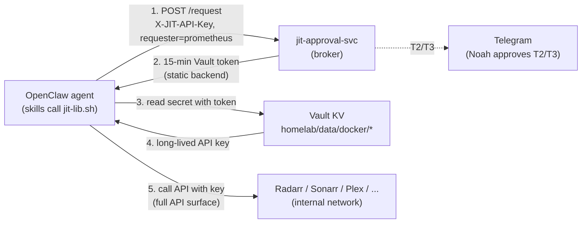
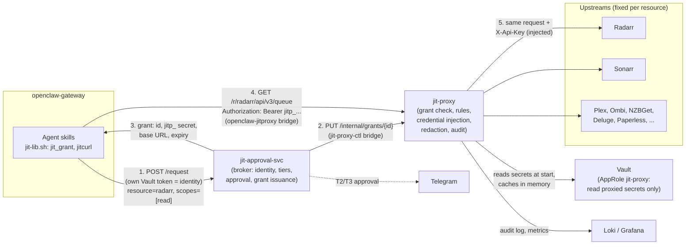
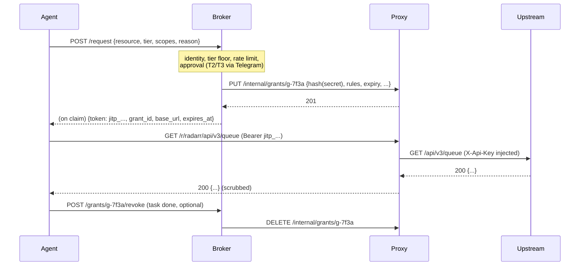

# JIT Credential Proxy: Grants Instead of Static Secrets — Design Document

> **Status:** Draft, for review
> **Author:** Claude (on Noah's direction)
> **Date:** 2026-11-07
> **Stakeholder:** Noah Kontur
> **Related:** [jit-access-design.md](../jit-access-design.md), [jit-webhook-design.md](../jit-webhook-design.md), [SECRET_ROTATION.md](../SECRET_ROTATION.md), [event-routing.md](./event-routing.md) (MR !1072), `docker/jit-approval-svc/README.md`, `docker/openclaw/API_SERVICES.md`

---

## Summary

The JIT broker (`docker/jit-approval-svc`) does its job well for the services
that can mint their own short-lived credentials: Grafana, InfluxDB, Home
Assistant, GitLab, Tailscale, SSH and Vault each get a credential that expires
on its own. For everything else (Radarr, Sonarr, Prowlarr, Plex, Ombi, NZBGet,
Deluge, Tautulli, and in practice Paperless) the broker hands the agent a
15-minute Vault token, the agent reads the **long-lived** API key or password
with it, and that value lands in the LLM context, in tool output and in session
transcripts. The JIT token expires; the key it unlocked does not. A leaked key
stays valid until someone rotates it by hand, and none of them has been
rotated.

This document proposes a **credential proxy**: a small service that holds the
static secrets and never gives them out. The agent asks the broker for a
**proxy grant** (short-lived, scoped to one resource and one set of HTTP rules,
bound to the requester) and calls the service *through* the proxy. The proxy
checks the grant, injects the real credential server-side, refuses anything
outside the grant's rules, scrubs secrets from responses and logs every call.

**Recommendation in brief**

1. Build `docker/jit-proxy/` as a **separate small Go service** (option B in 4.2), not a mode of `jit-approval-svc`. The broker stays the only place that approves and issues grants; the proxy only enforces them. The proxy gets its own Vault AppRole that can read the proxied services' secrets and nothing else: it cannot mint tokens, sign SSH certificates or write policies.
2. The agent reaches the proxy over a new two-member internal bridge (`openclaw-jitproxy`), the same pattern as `openclaw-browser`. The broker registers grants with the proxy over a second two-member bridge (`jit-proxy-ctl`).
3. Grants are bearer secrets with a `jitp_` prefix, 15 minutes by default (the tier TTL), with method/path rules from **reviewed per-service scope templates** in the repo (`read`, `write`, and a few narrow named ones). Destructive and outbound-mail templates are single-use. The approval tiers are unchanged: they now gate grant issuance.
4. Replace the shared `X-JIT-API-Key` plus self-declared `requester` with **per-client identity from Vault AppRole** (the broker looks up the caller's own Vault token), so a grant is bound to a requester nobody can forge.
5. Migrate in four phases (Radarr/Sonarr read-only first; Gmail last), switch each resource to proxy-only in the broker as it moves, then **rotate each secret once**, and add a scheduled rotation job for the services that can take a new key through config or API.
6. Prove the three invariants (never forward outside a grant's rules, never return a known secret, never accept an expired grant) with property and fuzz tests in the style the JIT service is getting now.

---

## 1. Problem statement

### 1.1 Current state



What the code does today (`docker/jit-approval-svc`, verified on `main`):

- **Request.** `POST /request` with an `X-JIT-API-Key` header (one key shared by
  every client, stored at `homelab/data/agents/jit-api-key`, readable by the
  `openclaw` AppRole) and a JSON body with `requester`, `resource`, `tier`,
  `reason`, optional `scopes` and `ttl`. The `requester` field is self-declared
  and checked against `ALLOWED_REQUESTERS` (`prometheus` only). Vault token
  metadata records `requester: prometheus` as a constant.
- **Tiers.** Tier 1 auto-approves (15 min), tier 2 (30 min) and tier 3 (60 min)
  wait for Noah's Telegram button; callbacks are only accepted from Noah's
  chat ID. `resourceTier` in `internal/vault/vault.go` sets a **minimum** tier
  per resource; a lower request is rejected. Per-resource TTL overrides live in
  `internal/config/config.go`.
- **Limits.** Issuance is rate-limited per resource per requester
  (`internal/ratelimit`: 50 per 15 minutes by default, configurable with
  `JIT_RATE_LIMIT_MAX`, which the deployment does not set; the handler comment
  and the README say 5). A credential
  is returned once (claim on first poll). Pending requests time out.
- **Backends** (`internal/backend/registry.go`). Dynamic backends are
  registered when their URL is configured; every other resource uses the
  static backend:

| Backend | Resources | What the agent receives | Expires by itself? |
|---|---|---|---|
| `GrafanaBackend` | `grafana` | Service account token with expiry | Yes |
| `InfluxDBBackend` | `influxdb` | Read-only authorization, deleted after TTL | Yes |
| `HomeAssistantBackend` | `homeassistant` | OAuth access token (refresh flow) | Yes |
| `GitLabBackend`, `GitLabAgentBackend` | `gitlab`, `gitlab-moltbot` | Project / impersonation token, revoked after TTL | Yes |
| `TailscaleBackend` | `tailscale` | OAuth access token | Yes |
| `SSHBackend` | `ssh-*` | Vault-signed SSH certificate | Yes |
| `VaultDynamicBackend` | `vault` | Vault token with a per-request policy | Yes (but see 1.2) |
| `GmailBackend` | `gmail-read`, `gmail-send` | Google OAuth access token (`gmail.readonly` / `gmail.send`) | Yes, about 1 h |
| `PaperlessBackend` | `paperless` (T2) | The admin user's DRF API token, fetched with the admin password | **No**: DRF tokens are persistent per user |
| `StaticBackend` | everything else in `resourceTier` | A Vault token that can read the static secret | **No**: the secret behind it is long-lived |

- **Failure behaviour.** `mintCredential` returns the backend's error and logs
  `dynamic_backend_failed`; there is no fallback from a dynamic backend to the
  static one. The README described a fallback until the docs audit (!1079)
  corrected it; the doc comment on `mintCredential` still says "falling back".

**Inventory of static secrets the agent can obtain today** (from
`resourceTier`, `registry.go`, `terraform/vault/policies.tf` and
`ansible/roles/fetch-vault-secrets/defaults/main.yml`):

| Resource | Min tier | Vault path | Credential | Auth style | HTTP API? | Other consumers of the same secret |
|---|---|---|---|---|---|---|
| `radarr` | 1 | `docker/radarr` | API key | `X-Api-Key` header | Yes | telegraf (queue, wanted, status), Prowlarr app sync, Ombi |
| `sonarr` | 1 | `docker/sonarr` | API key | `X-Api-Key` header | Yes | telegraf, Prowlarr app sync, Ombi |
| `prowlarr` | 1 | `docker/prowlarr` | API key | `X-Api-Key` header | Yes | Radarr/Sonarr indexer entries pushed by Prowlarr |
| `plex` | 1 | `docker/plex` | Plex account token | `X-Plex-Token` | Yes | Ombi, Tautulli, *arr Plex notifications |
| `ombi` | 1 | `docker/ombi` | API key | `ApiKey` header | Yes | none known |
| `nzbget` | 1 | `docker/nzbget` | username + password | HTTP basic auth, JSON-RPC | Yes | telegraf, Radarr/Sonarr download clients |
| `deluge` | 1 | `docker/deluge` | Web UI password | JSON-RPC `auth.login` then session cookie | Yes | telegraf `deluge-stats.sh`, Radarr/Sonarr download clients |
| `tautulli` | 1 | `docker/tautulli` | API key | `apikey` query parameter | Yes | telegraf |
| `paperless` | 2 | `docker/paperless` (admin user/password) | DRF token of the admin user | `Authorization: Token` | Yes | paperless-ai uses its own token |
| `pihole` | 2 | `infrastructure/pihole` | Admin / app password | Session (`sid`) | Yes | none known |
| `mqtt` | 1 | `mqtt/mosquitto` | Broker username/password | MQTT | **No** | many (HA, zigbee2mqtt, anomaly-detector) |
| `ipmi` | 2 | `infrastructure/ipmi` | BMC password | IPMI over LAN | **No** (Redfish may exist; not assumed) | none known |

The Gmail resources are already dynamic (short-lived OAuth access tokens, not
the IMAP app password the README describes). They still put a bearer token
for the whole mailbox scope into the agent's context, and `gmail-send` can mail
anyone; section 5.9 covers them. A legacy Gmail app password is still stored
in Vault; nothing in the broker maps a resource to it.

### 1.2 Why this matters

1. **The secret outlives the grant.** A tier-1 request is "15 minutes of
   access" on paper, but what the agent actually holds afterwards is a key with
   no expiry. Anything that sees the transcript, tool output or a shell
   history later (a log shipper, a backup, a prompt-injected sub-agent, a
   future model provider incident) gets indefinite access.
   `scrub-transcripts` redacts what gitleaks patterns recognise, after the
   fact; a bare 32-character hex API key does not look like a secret to most
   rules.
2. **The key is the whole API.** Every one of these services exposes, behind
   the same key, endpoints that reveal or change other credentials
   (download-client passwords, indexer keys, the Plex token inside Ombi's
   settings), change auth settings, regenerate keys, install updates, run
   scripts or delete libraries. The tier says "auto-approve Radarr"; the key
   says "administer Radarr".
3. **Scoping is per tier, not per resource.** The static backend attaches the
   tier's Vault policy (`jit-tier1-services` / `jit-tier2-infra`), so a token
   minted for one resource can read every path in that tier's policy, not only
   the one it was requested for.
4. **Identity is a shared secret.** One API key is shared by all clients and
   the requester names itself, so the audit trail's "who" is only as good as
   that key's confidentiality.
5. **Nothing rotates.** `SECRET_ROTATION.md` documents manual steps; these keys
   have their original values, and several are also rendered into telegraf's
   config.

---

## 2. Goals and non-goals

**Goals**

- G1. The agent never receives a long-lived static secret for any HTTP service the proxy covers.
- G2. What the agent can do with a service is the grant's rules, not the service's full API. Rules are reviewed config in the repo.
- G3. Every proxied call is attributable to a grant, a broker request and a requester, and is logged without secrets.
- G4. A leaked grant is worthless within minutes, and only ever worth its scope.
- G5. Approval stays exactly where it is: tiers gate issuance, Noah approves T2/T3 in Telegram.
- G6. After migration, every proxied secret is rotated once, and rotation is cheap enough to repeat.

**Non-goals**

- Non-HTTP protocols (MQTT, IPMI over LAN, SSH, IMAP/SMTP). MQTT and IPMI stay on the static backend with per-resource policies (8.4); SSH is already certificate-based.
- The dynamic backends (Grafana, InfluxDB, HA, GitLab, Tailscale, SSH, Vault). They already issue expiring native credentials. Putting them behind the proxy is possible later but not part of this design.
- Network-level isolation of the agent from the services. The agent can still open TCP connections to them on the `internal` network; without credentials, that is worth little (9.1, Q11).
- Human access. Noah keeps using the web UIs directly.

---

## 3. Design principle

**Secrets are held by code, used by code, and never shown to the model.** The
agent decides *what* to do; deterministic code decides whether that is allowed
and attaches the credential. This is the same split the event router design
(!1072) makes for remediation actions: the LLM chooses among operations that a
reviewed allowlist defines, and the allowlist is enforced outside the LLM.

Two corollaries shape the rest of the document:

- **Default deny at L7.** A grant lists what is allowed; anything not listed is refused, including paths that look harmless. New service versions add endpoints; they stay unreachable until a template change is reviewed.
- **Least privilege per component.** The broker approves; the proxy enforces; neither holds more Vault access than its job needs, and the agent holds no long-lived secrets at all.

---

## 4. Architecture

### 4.1 Overview



The flow:

1. The agent asks the broker for a grant exactly as it asks for a credential today, naming a resource, a tier, a reason and one or more **scope templates** (the existing `scopes` field).
2. The broker authenticates the caller, applies tier minimums, rate limits and approval, then creates a grant and registers it with the proxy (the proxy stores only a hash of the grant secret).
3. The broker returns the grant on the existing `/status` claim path, as a credential of type `proxy_grant`.
4. The agent calls `http://jit-proxy:8090/r/<resource>/<upstream path>` with the grant secret.
5. The proxy checks the grant and its rules, strips any credentials the agent sent, injects the real one, forwards to the fixed upstream, scrubs the response and logs the call.

### 4.2 Where the proxy lives: two options

| | **A. A mode of `jit-approval-svc`** | **B. Separate `jit-proxy` service (recommended)** |
|---|---|---|
| Grant table | Same in-memory store as requests; no registration channel | Broker is the source of truth and pushes grants to the proxy over a private bridge |
| Code reuse | Direct: logger, Vault client, config | Shared Go packages copied or moved to a common module; small duplication |
| Vault privilege of the component that parses upstream traffic | The broker's: mint tokens with tier policies, write per-request policies, sign SSH certificates, read every brokered secret | Read-only on the proxied services' paths |
| Attack surface added to the broker | Arbitrary upstream response parsing, JSON-RPC parsing, large bodies, streaming downloads | None beyond a small registration client |
| Resource profile | Broker is capped at 128 MB; streaming Paperless PDFs and Plex art through it competes with approval traffic | Own limits; can restart without dropping pending approvals |
| Failure coupling | Proxy bug or overload takes approvals down with it (SSH, GitLab, HA included) | Proxy down affects only proxied services; approvals keep working |
| Deploy | One image | One more image and compose service (same CI pattern as the broker) |
| Restart behaviour | Grants and requests lost together (as today) | Proxy restart loses grants; broker re-pushes active ones (4.4) |

**Recommendation: B.** The proxy is the component that touches untrusted
bytes (whatever the upstream returns and whatever the agent sends), so it
should be the one with the least to lose. Option A would put the parser next to
the keys to the whole Vault policy set. The cost of B is one registration
endpoint and one more service, which the repo already knows how to build and
deploy.

### 4.3 Network path

Today `openclaw-gateway` is on the `internal` macvlan (plus three two-member
internal bridges: `openclaw-nginx-bridge`, `openclaw-browser`,
`openclaw-relay`) and reaches the broker at `jit.lab.nkontur.com` through the
lab nginx. `jit-approval-svc` is on `internal` and on `jit-bridge` (shared with
nginx for the Telegram webhook). The media services are on `internal` (Plex,
Ombi and Tautulli also on `external`); Paperless is on `internal` and
`paperless-ai`.

Proposed:

| Network | Members | Purpose |
|---|---|---|
| `openclaw-jitproxy` (new, bridge, `internal: true`) | `openclaw-gateway`, `jit-proxy` | The only listener for agent traffic. The proxy binds its data-plane port to this network's address only. |
| `jit-proxy-ctl` (new, bridge, `internal: true`) | `jit-approval-svc`, `jit-proxy` | Grant registration and revocation (control plane). |
| `internal` (existing macvlan) | `jit-proxy` (outbound only) | Reaching upstreams and Vault. No listener here. |

The agent keeps reaching the broker the way it does now. Nothing new is
reachable from the LAN, the tailnet or the internet. On both bridges the
traffic is plain HTTP between exactly two containers, the same trust model as
the CDP link on `openclaw-browser`; the control plane additionally carries a
bearer key from Vault (defence in depth if a third container is ever attached
by mistake).

**Upstream path.** Where the lab nginx already terminates TLS for a service
(`radarr`, `sonarr`, `prowlarr`, `nzbget`, `deluge`, `tautulli`, `pihole`,
`paperless-ngx` under `*.lab.nkontur.com`), the proxy uses that HTTPS URL with
full certificate verification, as telegraf already does. Plex is reached on
its own TLS port; Ombi has no lab vhost and is reached over HTTP on `internal`
(or gains a vhost; Q6). The upstream base URL is per-resource config, never
taken from the request.

### 4.4 Grant registration and lifecycle



- **Registration happens before the agent sees the secret.** If registration fails, the request ends in `error` and nothing is returned (fail closed).
- **The proxy stores `SHA-256(secret)`**, never the secret. The broker hands the secret to the claimant once and forgets it, as it does with credentials now.
- **Proxy restart.** The proxy reports a boot ID on `/health`; the broker polls it (every 10 s) and re-registers every unexpired grant when the boot ID changes. Grant hashes and rules survive in the broker's memory, so the agent's grant keeps working.
- **Broker restart.** The broker loses its request store today; with grants it loses its copy too. The proxy keeps enforcing what it has until expiry. New grants need the broker.
- **Expiry** is enforced by the proxy on every request against its own clock (both containers share the host clock). Expired grants are swept from memory.
- **Revocation.** `DELETE /internal/grants/{id}` from the broker, triggered by: the agent finishing a task (`POST /grants/{id}/revoke` on the broker, callable only by the grant's requester); a **Revoke** button on the Telegram message for T2/T3 grants; a kill switch (`DELETE /internal/grants?resource=radarr` or all) for incidents.

---

## 5. Grant model

### 5.1 The grant record

| Field | Example | Notes |
|---|---|---|
| `grant_id` | `g-7f3a9c2e41d0` | Public; appears in logs, Telegram and the digest. |
| `secret` | `jitp_` + 43 chars (32 random bytes, base64url) | Given to the agent once. The prefix lets the transcript scrubber and the proxy's own redaction recognise it. Stored as a SHA-256 hash in the proxy. |
| `request_id` | `req-a1b2c3d4e5f6` | Links to the broker request, approval and reason. |
| `requester` | `openclaw` | Derived from authenticated identity (5.3), never from the request body. |
| `resource` | `radarr` | Must match the `/r/<resource>/` path prefix. |
| `templates` | `["read"]` | Names from the resource's template file (section 6). Rules are copied into the grant at issuance, so a template change never widens a live grant. |
| `tier` | `1` | Max of the requested tier and each template's minimum tier. |
| `issued_at`, `expires_at` | | TTL from the tier (or a shorter requested `ttl`); per-template caps can shorten it (e.g. Gmail send: 5 min). |
| `max_requests` | `1000` (T1 default), `1` for single-use | Counted in the proxy. |
| `rate` | 5 req/s, burst 20 | Token bucket per grant. A per-resource global bucket protects the upstream. |
| `max_request_body` | 1 MiB default | Per template; Paperless upload template raises it. |
| `single_use` | `false` | `true` for destructive and outbound-mail templates: the grant is spent by the first request that passes the rules, whatever the upstream answers. |
| `client_net` | `openclaw-jitproxy` | The listener the grant is valid on (one network per client). |

### 5.2 Requesting and receiving a grant

The request is the existing one; only the scopes name templates and the
credential has a new type:

```json
POST /request
{"resource": "radarr", "tier": 1, "scopes": ["read"], "reason": "Check download queue", "ttl": "10m"}
```

Claim response (unchanged envelope, new `type`):

```json
{
  "request_id": "req-a1b2c3d4e5f6",
  "status": "approved",
  "credential": {
    "token": "jitp_…",
    "lease_ttl": "10m0s",
    "metadata": {
      "type": "proxy_grant",
      "grant_id": "g-7f3a9c2e41d0",
      "base_url": "http://jit-proxy:8090/r/radarr",
      "templates": "read",
      "single_use": "false"
    }
  }
}
```

The Telegram approval message already shows `scopes`; for proxy resources it
shows the template names and a one-line description of each, so Noah approves
"Paperless: edit metadata, 30 min", not "paperless".

For resources that have moved to the proxy, the broker refuses any other
credential type: the static backend is no longer reachable for them (8.3).

### 5.3 Binding grants to an identity

Today the broker knows a caller only by the shared `X-JIT-API-Key`, and the
`requester` field is whatever the caller writes. Two options:

| | **Vault AppRole identity (recommended)** | **Per-client API keys** |
|---|---|---|
| How | The client logs in to Vault with its own AppRole (OpenClaw already does: role `openclaw`) and sends its Vault token. The broker calls `auth/token/lookup` and takes the role name / entity as the requester. | The broker holds a map of key hash → client name; each client gets its own key from Vault. |
| New secrets | None | One per client |
| Rotation | Existing `vault:rotate-approle` job | Another manual secret |
| Forgeable requester | No | No |
| What a broker compromise exposes | Clients' Vault tokens seen in the last hour (low value: `openclaw-ops` reads only agent config) | Key hashes |
| Clients without Vault | Need a key anyway | Native |

**Recommendation:** AppRole identity for every client that already talks to
Vault (today: OpenClaw), per-client keys only for a future client that cannot.
The `requester` body field becomes optional and must match the authenticated
identity if present. `ALLOWED_REQUESTERS` becomes a list of AppRole names.
The shared key is removed after one release of overlap. Vault token metadata
then records the real requester instead of the constant.

The grant is bound to that identity in two ways: the broker records it on the
grant (audit, revoke permission), and the proxy only accepts the grant on the
listener for that client's network (`client_net`). A grant copied out of the
OpenClaw container is not usable from anywhere else on the network.

### 5.4 Single-use and replay

- **Single-use grants** for templates that destroy or send: deleting a media file, removing a torrent with data, Gmail send, Paperless delete (if ever allowed). The agent asks for a fresh grant per destructive action, so each one is a separate, logged, rate-limited issuance; with tier 2 templates, a separate approval.
- **Bounded reuse** for read and routine write templates: a grant is good for its TTL and request budget. Replay by whoever holds the grant inside that window is the accepted residual risk (9.4), the same as for every dynamic credential today but with a much smaller scope.

---

## 6. Per-service scope templates

Templates live in `docker/jit-proxy/templates/<resource>.yml`, CODEOWNERS
`@root` like the broker. Each template has a minimum tier, rules, limits and a
description for the Telegram message. Rules are matched against the
**normalised** request (6.11) and the first matching `deny` wins over any
`allow`.

Example (abridged):

```yaml
resource: radarr
upstream: https://radarr.lab.nkontur.com
auth: {type: header, name: X-Api-Key, secret: {vault: homelab/data/docker/radarr, field: api_key}}
deny:                                    # applies to every template
  - {path: "/api/v3/config/**"}          # host config includes the API key
  - {path: "/api/v3/downloadclient/**"}  # download-client passwords
  - {path: "/api/v3/indexer/**"}         # indexer API keys
  - {path: "/api/v3/notification/**"}    # webhook URLs, Plex token
  - {path: "/api/v3/system/{backup,restart,shutdown}/**"}
  - {path: "/api/v3/update/**"}
  - {path: "/api/v3/log/file/**"}
templates:
  read:
    min_tier: 1
    description: "Read library, queue, history, calendar; search metadata"
    allow:
      - {method: GET, path: "/api/v3/movie", query: [tmdbId]}
      - {method: GET, path: "/api/v3/movie/{id:int}"}
      - {method: GET, path: "/api/v3/movie/lookup", query: [term]}
      - {method: GET, path: "/api/v3/queue", query: [page, pageSize, includeMovie]}
      - {method: GET, path: "/api/v3/history", query: [page, pageSize, movieId, eventType]}
      - {method: GET, path: "/api/v3/calendar", query: [start, end]}
      - {method: GET, path: "/api/v3/wanted/missing", query: [page, pageSize]}
      - {method: GET, path: "/api/v3/system/status"}
  write:
    min_tier: 1
    description: "Add movies, trigger searches, grab a release, manual import"
    includes: [read]
    allow:
      - {method: POST, path: "/api/v3/movie", body_max: 64KiB}
      - {method: POST, path: "/api/v3/command",
         json: {name: [MoviesSearch, RefreshMovie, RescanMovie, DownloadedMoviesScan]}}
      - {method: GET,  path: "/api/v3/release", query: [movieId]}
      - {method: POST, path: "/api/v3/release"}
      - {method: GET,  path: "/api/v3/manualimport", query: [folder, movieId, filterExistingFiles]}
      - {method: POST, path: "/api/v3/command", json: {name: [ManualImport]}}
  replace-file:
    min_tier: 1
    single_use: true
    description: "Delete one movie file (to re-download a better release)"
    allow:
      - {method: DELETE, path: "/api/v3/moviefile/{id:int}"}
  queue-remove:
    min_tier: 1
    single_use: true
    description: "Remove a stuck queue item, optionally blocklisting the release"
    allow:
      - {method: DELETE, path: "/api/v3/queue/{id:int}",
         query: {removeFromClient: [true, false], blocklist: [true, false]}}
  remove-title:
    min_tier: 2
    single_use: true
    description: "Remove a movie from the library (files kept unless approved otherwise)"
    allow:
      - {method: DELETE, path: "/api/v3/movie/{id:int}", query: {deleteFiles: [false]}}
```

The tables below give each service's templates at the level of detail needed
for review; the YAML is written from them in the implementation MR.

### 6.1 Radarr and Sonarr (`X-Api-Key` header)

| Template | Tier | Allows | Notes |
|---|---|---|---|
| `read` | 1 | `GET` movie/series (list, by id, lookup), episode, queue, history, calendar, wanted/missing, system/status | Today's `search.sh`, `check-downloaded.sh` |
| `write` | 1 | `POST` movie/series (add), `POST command` with name in {search, refresh, rescan, downloaded-scan, manual-import}, release search and grab, manual import | Today's `add.sh`, `manual-grab.sh` |
| `replace-file` | 1, single-use | `DELETE moviefile/{id}` / `episodefile/{id}` | Today's `delete-and-search.sh` (then a `write` grant to search) |
| `queue-remove` | 1, single-use | `DELETE queue/{id}` with `blocklist` and `removeFromClient` | Blocklist handling |
| `remove-title` | 2, single-use | `DELETE movie/{id}` / `series/{id}` with `deleteFiles=false` only | Deleting files with a title is not offered at all |

Always denied: `config/**` (host config carries the API key and auth mode),
`downloadclient/**`, `indexer/**`, `notification/**`, `importlist/**` (may hold
third-party tokens), `customformat` / `qualityprofile` writes, `system/backup`,
`system/restart`, `system/shutdown`, `update/**`, `log/file/**`. Tag writes
are added to `write` only when a skill needs them.

### 6.2 Prowlarr (`X-Api-Key` header)

| Template | Tier | Allows |
|---|---|---|
| `read` | 1 | `GET /api/v1/search`, `/api/v1/indexerstats`, `/api/v1/health`, `/api/v1/system/status`, `/api/v1/history` |
| `test-indexers` | 1 | `POST /api/v1/indexer/testall` (response is scrubbed; it can echo config) |

Always denied: `/api/v1/indexer` reads and writes (the indexer definitions
carry tracker credentials), `/api/v1/applications/**` (carry the Radarr and
Sonarr keys), `/api/v1/downloadclient/**`, `/api/v1/config/**`, backups,
updates.

### 6.3 NZBGet (JSON-RPC over HTTP, basic auth)

The proxy injects basic auth for NZBGet's **restricted user**
(`RestrictedUsername`), which by design cannot read or change settings, and
never the control user. Rules match `POST /jsonrpc` and then the parsed
JSON-RPC body: a single call only (no batches), method from the list, params
checked where it matters.

| Template | Tier | JSON-RPC methods |
|---|---|---|
| `read` | 1 | `status`, `listgroups`, `history` (without hidden), `listfiles`, `version` |
| `control` | 1 | `pausedownload`, `resumedownload`, `editqueue` with commands in {`GroupPause`, `GroupResume`, `GroupMoveTop`, `GroupMoveBottom`, `HistoryRedownload`, `HistoryReturn`} |
| `remove` | 1, single-use | `editqueue` with `GroupDelete` / `GroupFinalDelete` / `HistoryDelete` for the given IDs |

Always denied: `config`, `loadconfig`, `saveconfig`, `reload`, `shutdown`,
`scan`, `append` (makes NZBGet fetch an agent-chosen URL; downloads come from
Radarr/Sonarr), `writelog`, `log` (log lines can include URLs with keys), server
volume and server edit methods, and the URL-embedded credential form
(`/user:pass/jsonrpc`), which the proxy never uses.

### 6.4 Deluge (JSON-RPC, cookie session)

Deluge has no API key: the web UI takes `auth.login` with the web password and
sets a `_session_id` cookie. The proxy owns the session: it logs in when it
has none or the upstream answers "not authenticated", connects the web UI to
the daemon when `web.connected` is false, and keeps the cookie server-side.
The agent never sees a `Set-Cookie`, and any `Cookie` it sends is dropped.

| Template | Tier | JSON-RPC methods |
|---|---|---|
| `read` | 1 | `web.update_ui`, `core.get_torrents_status`, `core.get_torrent_status`, `core.get_session_status`, `core.get_free_space`, `label.get_labels` |
| `control` | 1 | `core.pause_torrent`, `core.resume_torrent`, `core.force_recheck`, `core.force_reannounce`, `core.queue_*`, `label.set_torrent` |
| `remove` | 1, single-use | `core.remove_torrent` with `remove_data=false`; `remove_data=true` is a separate tier-2 single-use template |

Always denied: `auth.*` (the proxy's own login aside), `web.connect` /
`web.add_host` / `web.remove_host` (host management), `core.set_config`,
`web.set_config`, `core.add_torrent_*` (fetches agent-chosen URLs and writes
files; downloads come from the *arr apps), every plugin enable/disable and
plugin-specific method (some plugins run commands), `daemon.*`.

### 6.5 Paperless-ngx (`Authorization: Token`)

Today the backend logs in as the **admin** user and hands out the admin's
persistent token. The proxy instead uses a dedicated `jit-agent` Paperless
user whose own permissions (Paperless object permissions) are view and change
on documents, tags, correspondents and document types, with no delete, no
admin, no mail and no workflow rights. The proxy rules and Paperless's own
permission model then both have to agree before anything happens.

| Template | Tier | Allows |
|---|---|---|
| `read` | 1 | `GET` documents (list, search, by id, `download`, `preview`, `thumb`, `notes`), `tags`, `correspondents`, `document_types`, `storage_paths`, `custom_fields`, `saved_views`, `search/autocomplete` |
| `edit` | 2 | `PATCH documents/{id}` (title, tags, correspondent, type, created date, custom fields); `POST documents/bulk_edit` with `method` in {`add_tag`, `remove_tag`, `modify_tags`, `set_correspondent`, `set_document_type`}; `POST documents/{id}/notes` |
| `upload` | 2 | `POST documents/post_document` (body cap 50 MiB, PDF/image content types) |

Today's tier-2 minimum for `paperless` becomes the `edit`/`upload` minimum;
`read` drops to tier 1 because it no longer exposes a credential. That is a
**loosening of approval** for document reads (Q9).

Always denied: `users/**`, `groups/**`, `profile/**` (token regeneration),
`mail_accounts/**` and `mail_rules/**` (IMAP passwords), `workflows/**`
(can call webhooks), `share_links/**` (creates public links),
`config/**`, `tasks` writes, `bulk_edit` with `delete` / `merge` / `split` /
`rotate` / `set_permissions`, `DELETE documents/{id}`, `trash/**`.

### 6.6 Plex (`X-Plex-Token` header)

The stored credential is Noah's **Plex account token**, which also works
against plex.tv for the whole account. The proxy injects it as a header (never
a query parameter, so it stays out of upstream access logs) and only towards
the local server URL; plex.tv is never an upstream.

| Template | Tier | Allows |
|---|---|---|
| `read` | 1 | `GET /library/sections`, `/library/sections/{id}/all`, `/library/metadata/{id}` (and `/children`), `/library/recentlyAdded`, `/hubs/search`, `/search`, `/status/sessions` (now playing), `/identity` |
| `refresh` | 1 | `GET`/`PUT /library/sections/{id}/refresh`, `PUT /library/metadata/{id}/refresh`, `PUT /library/sections/{id}/analyze` |

Always denied: `/:/prefs` (server settings, including tokens), `/myplex/**`,
`/accounts/**`, `/security/**` (token exchange), `/system/**`, `/servers/**`,
`/clients/**` and `/player/**` (remote control), `/playlists` writes,
`/library/sections` writes other than refresh, `/butler/**`, `/updater/**`,
`/diagnostics/**`, `/transcode/**` and `/video/**` (media streaming is not an
agent task, and transcoder URLs carry tokens). Responses are scrubbed for
`X-Plex-Token=` and `accessToken` values (7.2).

### 6.7 Ombi (`ApiKey` header)

| Template | Tier | Allows |
|---|---|---|
| `read` | 1 | `GET` movie and TV requests (list, by id), request counts, search endpoints |
| `requests` | 1 | `POST` movie and TV requests (create on Noah's behalf), approve, deny, mark available |

Always denied: `/api/v1/Settings/**` (holds the Plex token and the Radarr and
Sonarr keys), `/api/v1/Identity/**` and other user-management endpoints,
token endpoints, `/api/v1/Notifications/**` settings, job triggers that
re-sync settings. Ombi's own `ApiKey` acts as the admin; the denylist is
therefore the main control, and Ombi is one of the services where the
redaction pass matters most.

### 6.8 Tautulli (`apikey` query parameter)

Tautulli's API is `GET /api/v2?apikey=…&cmd=…`. The proxy adds `apikey`
upstream, refuses any agent-supplied `apikey`, and matches on `cmd`:

| Template | Tier | `cmd` values |
|---|---|---|
| `read` | 1 | `get_activity`, `get_history`, `get_home_stats`, `get_libraries`, `get_library_media_info`, `get_recently_added`, `get_user_watch_time_stats`, `get_plays_by_date` and other `get_plays_*`, `get_server_info` |

Always denied: every other `cmd`, explicitly `get_settings`, `get_apikey`,
`get_server_pref`, `set_*`, `delete_*`, `edit_*`, `add_*` (notifiers,
newsletters run scripts or call URLs), `notify*`, `restart`, `update`,
`backup_*`, `import_database`, `download_*`, `get_logs`. Because the key
travels in the upstream query string, the proxy logs the path with the query
removed.

### 6.9 Gmail (`Authorization: Bearer`, Google REST API)

IMAP and SMTP are not HTTP, but the agent already uses the Gmail REST API
with OAuth access tokens (`gmail-read`, `gmail-send`), so Gmail fits the proxy
without a service account. The difference is who holds the access token: the
broker mints it with the existing `GmailBackend` and passes it to the proxy in
the grant registration (only over `jit-proxy-ctl`); the agent gets a `jitp_`
grant. The Google client secret and refresh tokens stay with the broker.
Upstream is fixed to `https://gmail.googleapis.com`.

| Template | Tier | Allows | Notes |
|---|---|---|---|
| `read` | 1 | `GET users/me/messages` (list, with `q`), `messages/{id}` (format metadata/full), `threads` (list, get), `labels` (list), `history` | Same scope as today's `gmail.readonly` |
| `send-self` | 1, single-use | `POST users/me/messages/send` when **every** recipient (To, Cc, Bcc, after MIME parsing) is on the recipient allowlist (Noah's own addresses) | Reports and reminders to Noah need no prompt |
| `send` | 2, single-use, 5 min | `POST users/me/messages/send` to anyone; the Telegram approval shows recipients, subject and the first lines of the body, and the proxy only accepts a message whose recipients and subject hash match what was approved | Outbound email is the most security-sensitive action here |

Always denied: `users/me/settings/**` (forwarding addresses, filters,
delegates, send-as: the classic persistent exfiltration path), `drafts`,
`messages/{id}/trash`, `delete`, `batchDelete`, `modify` (no `gmail.modify`
scope is granted anyway), `import`, `insert`, attachments larger than the body
cap. The alternative of keeping Gmail out of the proxy behind a narrow
send/read helper is in section 12 (Q8).

### 6.10 Pi-hole (session from app password)

Pi-hole is tier 2 today. The proxy logs in with the app password, holds the
session ID (`X-FTL-SID`) and offers:

| Template | Tier | Allows |
|---|---|---|
| `read` | 1 | `GET /api/stats/**`, `/api/queries` (with limits), `/api/info/**` without `login` |
| `block-toggle` | 2 | `POST /api/dns/blocking` with a timer of at most 30 minutes |
| `lists` | 2 | `POST`/`DELETE /api/domains/{type}/{kind}/{domain}` (allow/deny one domain) |

Always denied: `/api/auth/**` (other than the proxy's login), `/api/config/**`,
`/api/teleporter`, `/api/action/**` (restart, flush), `/api/network/**` writes.

### 6.11 Rule semantics common to all templates

- **Normalisation before matching.** Percent-decode once; reject (do not "fix") paths containing `..`, `//`, `\`, `%2f`/`%5c` after decoding, NUL, `;` path parameters, or a non-origin-form request target. Match the canonical path; forward exactly the canonical path.
- **Query.** Only listed parameter names pass; values can be enumerated or typed (`int`, `bool`, `date`); duplicates are rejected.
- **Bodies.** JSON bodies on rule-checked endpoints are parsed with a size cap and duplicate-key rejection; JSON-RPC requires a single object (no batch arrays). Everything else is passed through only where the rule says so.
- **Methods.** Only those listed. `CONNECT`, `TRACE`, WebSocket upgrades and HTTP/2 prior-knowledge from the agent are refused.

---

## 7. Request and response safety

### 7.1 Requests

| Control | Detail |
|---|---|
| Fixed upstream | Base URL per resource in config. The request selects a resource by path prefix, never a host. No `Host`, `X-Forwarded-Host` or absolute-URI influence. No redirects followed (a 3xx is returned as-is with `Location` scrubbed to a path or dropped if off-origin). This is the SSRF control: the proxy cannot be pointed anywhere new. |
| Credential stripping | Drop every inbound credential-bearing header and parameter before injection: `Authorization`, `Cookie`, `X-Api-Key`, `ApiKey`, `X-Plex-Token` (header and query), `apikey`/`api_key`/`token` query params, `X-FTL-SID`. Then inject exactly one credential for the resource. |
| Hop-by-hop and identity headers | Drop `Connection`, `Upgrade`, `Proxy-*`, `Forwarded`, `X-Forwarded-*`, `X-Real-IP` from the agent; set upstream `Host` from config. |
| Body limits | 1 MiB default, per-template overrides (Paperless upload 50 MiB). `Content-Length` required or chunked bodies are counted and cut off. |
| Timeouts | Upstream connect 5 s, response headers 30 s, total 120 s (downloads 10 min). |
| TLS to upstreams | HTTPS with verification wherever a lab vhost or native TLS exists (4.3). Plain HTTP only on `internal` for services without TLS, listed explicitly in config. |
| Upstream-triggered fetches | Endpoints that make a service fetch an agent-supplied URL (NZBGet `append`, Deluge `add_torrent_url`, Paperless workflows) are denied; SSRF by proxy-of-a-proxy is closed at the rule layer. |

### 7.2 Responses

| Control | Detail |
|---|---|
| Known-secret scrub | The proxy knows every secret it holds (all resources, not only the one being called). Every text response body and every header is scanned for those values in raw, URL-encoded, JSON-escaped and base64 forms (Aho-Corasick over the stream, carrying overlap across chunks). A hit is replaced with `[REDACTED]`, logged as `secret_echo_redacted` with grant and path, and counted. |
| Pattern scrub | JSON fields named `apiKey`, `api_key`, `apikey`, `password`, `token`, `accessToken`, `authToken`, `secret`, `sid` are redacted wherever they appear; `X-Plex-Token=…` and `apikey=…` in URLs are redacted; `jitp_` strings are redacted (a grant never echoes back). |
| Header hygiene | Drop `Set-Cookie` and any credential-bearing response header; pass the rest. |
| Content types | Binary types (PDF, images) are streamed with the known-secret scan only; text types get both scans. Unknown types on rule-checked JSON endpoints are refused. |
| Size | Response cap per template (JSON 10 MiB, downloads 200 MiB) so a scrape cannot exhaust the proxy. |
| Sensitive endpoints | Endpoints that exist only to reveal or change credentials are in the always-deny lists in section 6, so redaction is a second line, not the plan. |

---

## 8. Audit, rotation and migration of the static backend

### 8.1 Audit

Every proxied call logs one JSON line (the house format, to Loki through the
Docker log driver):

```json
{"ts":"2026-11-20T14:30:00Z","level":"info","event":"proxy_request","grant_id":"g-7f3a9c2e41d0","request_id":"req-a1b2c3d4e5f6","requester":"openclaw","resource":"radarr","template":"read","rule":"GET /api/v3/queue","method":"GET","path":"/api/v3/queue","query_keys":["page","pageSize"],"decision":"allow","status":200,"bytes":18234,"upstream_ms":42,"redactions":0}
```

- Never logged: bodies, query values, header values, grant secrets, upstream credentials. Denials log the reason (`no_rule`, `denylist`, `expired`, `revoked`, `budget`, `rate`, `body_too_large`, `normalisation`) and the canonical path.
- Grant lifecycle events (`grant_registered`, `grant_revoked`, `grant_expired`, `grant_spent`) come from both broker and proxy, keyed by `grant_id`.
- Metrics on `/metrics` (scraped like the rest): `jitproxy_requests_total{resource,template,decision,status_class}`, `jitproxy_redactions_total{resource,kind}`, `jitproxy_grants_active{resource}`, `jitproxy_upstream_seconds`.
- Alerts (Grafana rules): any `secret_echo_redacted` (a template lets a credential through: fix the template), proxy down for 5 min, denial rate above baseline for 15 min (agent fighting the rules or a skill out of date), upstream 5xx rate.
- **Daily summary.** `GET /summary?hours=24` (same shape as the anomaly detector's `/digest`) returns grants issued per resource and template, calls, denials by reason, redactions, revocations. The morning digest includes it; once the event router (!1072) exists, its digest consumes the same endpoint.

### 8.2 Rotation

**One-time rotation.** A key that was ever handed to the agent must be treated
as disclosed. After a service's cutover (no static path left for it), rotate
its secret once:

1. Generate the new value; write it to Vault (new KV version).
2. Apply it to the service (table below).
3. Update every other consumer of that secret: telegraf (`docker/telegraf/telegraf.conf` renders the Radarr, Sonarr, NZBGet, Deluge and Tautulli secrets), the service-to-service links that live in application databases (Prowlarr's app entries for Radarr/Sonarr, the *arr download-client entries for NZBGet/Deluge, Ombi's Radarr/Sonarr/Plex settings, Tautulli's Plex token, the *arr Plex notification connections), and any Home Assistant integration that uses the key.
4. The proxy re-reads the secret (SIGHUP, or automatically on an upstream 401 with a re-read rate limit) and verifies with a read call.
5. Confirm the old value fails.

**Recurring rotation** as a scheduled CI job (`secrets:rotate-proxied`, same
shape as `vault:rotate-approle`), monthly for services that support it, one
service per run, with a verification step and a Telegram notice on failure:

| Service | How a new key is applied | Scheduled rotation? |
|---|---|---|
| Radarr, Sonarr, Prowlarr | The key can be set from config (`config.xml`, or `*__AUTH__APIKEY` environment variables in current Servarr releases; verify on the deployed versions) and rendered from Vault by Ansible; rotation is a Vault write plus redeploy of the service and its consumers. | **Yes** |
| Paperless-ngx | Per-user token regeneration through the API (`profile` token endpoint) for the `jit-agent` user. | **Yes** |
| Deluge | `auth.change_password` over JSON-RPC (web password), then update the *arr download-client entries. | **Yes** (consumers in app DBs need the *arr API: scriptable) |
| NZBGet | Restricted-user password in `nzbget.conf` (config-as-code), reload. | **Yes** |
| Pi-hole | App password regenerated through the API. | **Yes** |
| Tautulli | `api_key` in `config.ini`, or regenerate in the UI. | Partly (config file: yes once it is templated) |
| Ombi | Regenerate in the UI. | Manual (yearly) |
| Plex | Account token; a new one means signing out devices on plex.tv and re-linking Ombi/Tautulli/*arr. | Manual, only on suspicion |
| Gmail | Access tokens are already short-lived; refresh tokens need re-consent. Revoke the legacy app password once confirmed unused. | n/a |

### 8.3 Phasing out the static backend

Per resource, when it moves:

1. Add the resource to the broker's `proxy_only` set: requests without proxy templates are rejected with a message pointing to the new path.
2. Remove the resource's path from `jit-tier1-services` / `jit-tier2-infra` in `terraform/vault/policies.tf`, so no Vault token minted by the broker can read it any more.
3. Rotate (8.2).
4. Update the skill and `API_SERVICES.md`.

### 8.4 Interim hardening for what stays static

MQTT and IPMI stay on the static backend. Independently of the proxy, the
static backend should attach a **per-resource** policy (`jit-static-<resource>`
reading one path) instead of the tier-wide one. This is a small change in
`policiesForResource` plus Terraform policies, and is worth doing in phase 1
for every static resource, including the ones about to move, because it
narrows exposure immediately.

---

## 9. Threat model

### 9.1 Prompt-injected or misbehaving agent

The agent reads untrusted text (email, web pages, media metadata, Paperless
OCR). Assume it can be steered.

| | Today | With the proxy |
|---|---|---|
| What it can obtain | The long-lived key for any tier-1 static resource, auto-approved, plus every other path in the tier policy | A grant for the templates it asks for; tier rules unchanged |
| What it can do with it | Everything the service's API allows: read other credentials from settings, change auth, add notification webhooks (persistent exfiltration), delete libraries, run scripts via notifiers or plugins | Only the template's rules; settings, auth, notifications, plugins and URL-fetching endpoints are unreachable |
| Exfiltration | Send the key anywhere; it works from anywhere, forever | A grant only works on the OpenClaw bridge, for minutes; it is useless elsewhere |
| Damage within scope | Unbounded | Bounded by single-use for destructive templates, per-grant rate and budget, tier 2 for removal with files and for outbound mail to others; every action is logged and in the digest |

Residual risk: within an allowed template, an injected agent can still do
in-scope harm (grab bad releases, mislabel documents, mail Noah). That is a
behaviour problem the rules bound but cannot remove.

### 9.2 Compromised proxy

The proxy holds the static secrets of the services it covers, just as the
broker (which can read them) and, today, the agent do. Compromise gives an
attacker those secrets and a position to tamper with responses.

Mitigations, all aimed at a small surface:

- Own AppRole, policy read-only on exactly the proxied paths; no token creation, no SSH signing, no policy writes, no Telegram token, no GitLab token.
- Standard Go `net/http` and `encoding/json`, no plugin system, minimal dependencies (Renovate-tracked), distroless image, read-only root filesystem, `cap_drop: ALL`, `no-new-privileges`, memory limit.
- Listens on two internal bridges only; the agent's bridge and the control bridge are separate listeners with separate handlers.
- Secrets in memory only; never written to disk or logs.
- Gmail: only short-lived access tokens are handed to the proxy; the refresh tokens stay with the broker.

Compared to today, the set of components that can see each static secret
shrinks from {broker, agent, transcripts, anything reading them} to {broker,
proxy}.

### 9.3 Grant theft from transcripts and tool output

A grant secret appears in the agent's tool output when `jit-lib.sh` fetches
it. Mitigations: the helper keeps the grant in a file under `/tmp` (mode
0600) and never prints it, so it should not reach the model at all; if it
does, the `jitp_` prefix makes it trivially scrubbable (add a rule to
`gitleaks-transcripts.toml`); the grant expires in 15 minutes by default and
only works from the OpenClaw bridge; it is scoped to one resource and its
templates. A transcript read a day later holds nothing usable. Today the same
transcript can hold a key that still works.

### 9.4 Replay

- **Requests:** a grant holder can repeat allowed requests inside the TTL and budget. Destructive and mail templates are single-use, so replaying them fails. Read replays are harmless by definition of the template.
- **Grant registration:** the control endpoint is idempotent on `grant_id` and rejects a registration whose expiry is in the past or beyond the tier maximum.
- **Approvals:** unchanged; Telegram callbacks are accepted once, only from Noah's chat, only while pending.
- **Gmail send approval:** the approved message's recipients and subject hash are bound to the single-use grant, so an approved grant cannot be used to send a different message.

### 9.5 Other

| Threat | Control |
|---|---|
| Spoofed requester at the broker | AppRole identity (5.3); body field cannot override it. |
| Forged grant registration | Control plane only on `jit-proxy-ctl` (two members) plus a bearer key from Vault. |
| Path tricks to escape rules | Normalise-then-match, reject ambiguous encodings, forward the canonical path (6.11); fuzzed (section 11). |
| Upstream echoes another service's secret (e.g. Ombi settings) | Endpoint denylisted; known-secret scrub covers all held secrets, not only the called resource's. |
| Proxy used as a pivot to arbitrary hosts | No request-chosen upstream, no redirects followed, URL-fetching endpoints denied. |
| Denial of service against upstreams | Per-grant and per-resource token buckets; issuance rate limit at the broker. |

---

## 10. Failure modes

| Failure | Behaviour | Notes |
|---|---|---|
| **Proxy down** | Proxied services are unavailable to the agent. `jit-lib.sh` reports "credential proxy unavailable" and does **not** fall back to a static secret (none is issuable once a resource is `proxy_only`). Grafana alert after 5 min. | Fail closed. Media and document tasks are never urgent. The event router (!1072) never needs these services: its playbooks restart containers and read Grafana, Loki and GitLab, none of which go through the proxy. |
| **Broker down** | No new grants. Grants already registered keep working until expiry. | Same as today for all JIT resources. |
| **Proxy restarts** | Broker detects the new boot ID and re-registers live grants within about 10 s; in-flight requests fail and the helper retries once. | |
| **Vault down** | Proxy keeps serving from secrets cached in memory. A proxy started while Vault is down serves nothing (fail closed) and reports unhealthy. | Secrets are never cached on disk. |
| **Upstream down or slow** | `502`/`504` with a structured error naming the resource; no retries for non-idempotent methods; one retry for `GET`. | The grant budget is not charged for upstream failures, except single-use grants (spent on the first allowed attempt, by design). |
| **Upstream rejects the injected credential (401/403)** | Re-read the secret from Vault (at most once a minute), retry once, then `502 upstream_auth_failed` and an alert. | This is the signal during rotation. |
| **Template too narrow** | `403 rule_denied` with the rule set name; the agent reports what it tried; the denial appears in the digest. | Widening is a reviewed MR to the template file. |
| **Approval flow** | Unchanged. Tier 2/3 templates wait for Noah; timeouts and denials behave as today. | |

---

## 11. Verification

The JIT service is getting property and fuzz tests now (`test/jit-fuzz`);
the proxy uses the same tooling (Go native fuzzing plus property tests with
generated inputs) and ships with them from its first MR. The three invariants
Noah asked for are the core; each is checked against an `httptest` upstream
that records every request it receives.

| # | Invariant | How it is tested |
|---|---|---|
| I1 | **The proxy never forwards a request outside the grant's rules.** For any grant (random templates) and any request (fuzzed method, raw target, query, headers, body), if the recording upstream receives a request then its method, canonical path, query keys and parsed JSON-RPC method satisfy at least one allow rule and no deny rule of that grant, and its host is the configured upstream. | Fuzz target over raw HTTP request bytes; property test over generated grants. Includes a differential check: the decision on a raw path equals the decision on its canonical form. |
| I2 | **The proxy never returns a known secret value.** For any upstream response (fuzzed bodies and headers that embed any held secret at random positions, split across chunk boundaries, raw/URL-encoded/JSON-escaped/base64), the bytes returned to the agent contain none of those encodings of any held secret, and no `jitp_` grant secret. | Fuzz target over response bodies and chunking; corpus seeded with real (scrubbed) responses from each service's settings endpoints. |
| I3 | **The proxy never accepts an expired, revoked, spent or unknown grant.** For any sequence of register, revoke, use and clock-advance operations, a request is forwarded only if its grant is registered, unrevoked, `now < expires_at`, under budget, and (if single-use) unused; otherwise the upstream sees nothing. | Property test with a fake clock over random operation sequences. |
| I4 | No upstream credential ever appears in a log line. | Capture the logger in all of the above; assert no held secret or encoding of it appears. |
| I5 | Agent-supplied credentials are never forwarded upstream. | Generated requests carrying credentials in every stripped header/param; assert the upstream sees only the injected one. |

**Mutation checks** (as in the event-router model): each deliberate bug must
make a test fail, or the tests are too weak:

1. Match the raw path instead of the canonical one → I1 fails.
2. Skip the scan on the last chunk of a streamed body → I2 fails.
3. Compare `now <= expires_at` with a stale clock read cached per connection → I3 fails.
4. Forget to mark a single-use grant spent when the upstream errors → I3 fails.
5. Log the full upstream URL for Tautulli → I4 fails.

Plus golden tests per template (each skill's real calls must pass; a list of
known-dangerous endpoints per service must be denied), and a staging run in
phase 1 against the real Radarr/Sonarr with the proxy in **log-only** mode for
a week before enforcement.

---

## 12. OpenClaw changes

### 12.1 The helper library

`tools/jit-lib.sh` (in the agent workspace) gains:

- `jit_grant <resource> <template[,template]> [ttl]`: requests a grant (blocking for approval when the tier needs it), stores it in `/tmp/jit-grants/<resource>-<templates>` (mode 0600) with its expiry, reuses it until 60 s before expiry, never prints the secret.
- `jitcurl <resource> <template> <method> <path> [curl args…]`: ensures a grant, then runs `curl` against `$JIT_PROXY_URL/r/<resource><path>` with the grant header. Exit code and stderr distinguish `rule_denied`, `grant_expired`, `proxy_unavailable` and upstream errors.
- `jit_grant_revoke <resource> <template>`: revokes and deletes the cached grant (skills call it at the end of a destructive flow).

`jit_service_key` is kept for the resources that have not moved and returns
an error naming the new helper for those that have. (It currently requests
tier 1 for every service, which the broker already rejects for `paperless`.)

Because the helper is security-relevant and lives only in the workspace
today, it moves into the repo (`docker/openclaw/workspace/tools/`), deployed
read-only like `TOOLS.md` (Q12).

### 12.2 Before and after: `radarr/scripts/check-downloaded.sh`

Before:

```bash
source /home/node/.openclaw/workspace/tools/jit-lib.sh
RADARR_KEY=$(jit_service_key radarr T1 "check" 2>/dev/null)   # long-lived key, now in this process

curl -sf "http://radarr:7878/api/v3/movie/${MOVIE_ID}" -H "X-Api-Key: ${RADARR_KEY}" | python3 -c '…'
```

After:

```bash
source /home/node/.openclaw/workspace/tools/jit-lib.sh

jitcurl radarr read GET "/api/v3/movie/${MOVIE_ID}" -sf | python3 -c '…'
```

`delete-and-search.sh` becomes two calls: `jitcurl radarr replace-file DELETE
"/api/v3/moviefile/${FILE_ID}"` (single-use grant) and `jitcurl radarr write
POST /api/v3/command -d '{"name":"MoviesSearch",…}'`.

### 12.3 Other changes

- Skill docs (`radarr`, `sonarr`, `plex`, `ombi`, `nzbget`, `deluge`, `tautulli`, `paperless-ngx`, `imap-email`) switch their "Authentication" section from "header with key" to "use `jitcurl`, templates: …".
- `docker/openclaw/API_SERVICES.md` drops the "add an API key as a CI variable" instructions for proxied services and documents the proxy and templates.
- `TOOLS.md` credential rule becomes: "Service APIs only through `jitcurl`; never ask for or read a service key."
- Compose: `openclaw-gateway` joins `openclaw-jitproxy`; `JIT_PROXY_URL` env var.

---

## 13. Rollout plan

| Phase | Scope | Exit criteria |
|---|---|---|
| **0. Prerequisites** (small MRs) | Per-resource Vault policies for static resources (8.4). AppRole identity at the broker alongside the shared key. | Static tokens read one path; broker logs the authenticated requester on every request. |
| **1. Proxy + Radarr/Sonarr read-only** | `docker/jit-proxy/` service, both bridges, AppRole `jit-proxy`, broker grant issuance and registration, `read` templates for Radarr and Sonarr, audit log, metrics, `/summary`, invariants I1 to I5 in CI. One week **log-only** (requests that miss the template allow rules are forwarded and logged as would-deny; the always-deny lists are enforced from day one), then enforce. `jitcurl` in the helper; `search.sh` and `check-downloaded.sh` switch. | Zero `secret_echo_redacted`; denial log reviewed and templates adjusted; all Radarr/Sonarr read calls in skills go through the proxy for a week. |
| **2. Remaining *arr and download clients** | `write`, `replace-file`, `queue-remove`, `remove-title` for Radarr/Sonarr; Prowlarr; NZBGet (restricted user); Deluge (session handling); Tautulli. Mark each `proxy_only`; remove from tier policies; rotate Radarr, Sonarr, Prowlarr, NZBGet, Deluge, Tautulli and update telegraf and app links. | No static issuance for these resources for 2 weeks; rotation done and old values verified dead. |
| **3. Paperless, Plex, Ombi** | `jit-agent` Paperless user and templates; Plex `read`/`refresh`; Ombi `read`/`requests`; Pi-hole if wanted. `proxy_only`; rotation (Paperless token, Ombi key; Plex token per Q7). | As phase 2. |
| **4. Gmail** | Decision in Q8. If proxied: `read`, `send-self`, `send` with recipient binding; broker passes access tokens on registration; agent stops receiving Google tokens. Revoke the legacy app password. | No Google access token claimed by the agent for 2 weeks. |
| **After each phase** | Scheduled rotation job enabled for the services in that phase that support it (8.2). | First scheduled rotation passes with no consumer breakage. |

**Success metrics**

| Metric | Target |
|---|---|
| Static secrets claimable by the agent for HTTP services | Zero after phase 3 (MQTT and IPMI excepted by design) |
| Static-backend issuances per week for migrated resources | Zero (any is a bug) |
| `secret_echo_redacted` events | Zero after the log-only week; each one is a template fix |
| Legitimate calls denied (denials later fixed by a template change) | Under 1% of calls after each phase's first two weeks |
| Proxied secrets older than their rotation interval | Zero for the "Yes" rows in 8.2 |
| Proxy availability | Matches the broker's |

---

## 14. Alternatives considered

| Alternative | Pros | Cons | Verdict |
|---|---|---|---|
| **Status quo plus scrubbing** (better gitleaks rules, faster rotation) | No new service | The agent still holds full-API keys; scrubbing is after the fact and pattern-based; rotation alone does not narrow scope | Not enough |
| **Vault + Boundary** | HashiCorp-native; brokered sessions, credential injection, session recording | Credential injection targets SSH/TCP sessions, not HTTP method/path rules; no response scrubbing; controller + worker + database to run; a second identity system | Too heavy, wrong layer |
| **oauth2-proxy** | Small, mature, one container per upstream | Authenticates humans via OIDC; no per-grant scope, no approval tie-in, no injection of per-service API keys beyond static headers, no redaction | Solves a different problem |
| **Pomerium** (or Envoy + `ext_authz`) | Real L7 policy (method, path, headers), header injection, good audit; ext_authz would let the broker be the decision point | Policy model is identity- and route-based, not short-lived grant-based, so we would still write the grant service; JSON-RPC and query-command rules and response scrubbing need custom filters (Lua/Wasm); large config surface for a handful of upstreams | Credible; more moving parts than the problem needs |
| **Teleport application access** | Closest concept: short-lived certs, access requests with approval, per-app audit | Per-app, not per-path, authorisation; replaces the broker's approval flow instead of reusing it; separate auth/proxy services and CA; header rewrite only for injection; no scrubbing | Too heavy; would duplicate the broker |
| **Per-service scoped keys instead of a proxy** | No proxy at all | Most of these services have one all-powerful API key and no scopes (Servarr, Ombi, Tautulli, Plex); only Paperless (users), NZBGet (restricted user) and Pi-hole (app passwords) offer any narrowing | Use where available *inside* the proxy (6.3, 6.5), not instead of it |
| **Option A: proxy as a mode of `jit-approval-svc`** | One service, no registration channel | Puts the parser next to the broker's Vault privileges; couples failures (4.2) | Rejected in favour of B |
| **Recommended: small in-repo `jit-proxy`** | Fits the broker's patterns (Go, structured logs, Vault AppRole, CI build); rules as reviewed YAML; testable invariants; least privilege | One more service to own; templates need upkeep when service APIs change | Recommended |

---

## 15. Open questions (each with a recommended default)

| # | Question | Recommendation |
|---|---|---|
| Q1 | Separate service or a mode of the broker? | **Separate `jit-proxy`** (option B, 4.2). |
| Q2 | How do clients prove identity to the broker? | **Vault AppRole token lookup**; per-client keys only for clients without Vault; shared key removed after one release of overlap. |
| Q3 | How does the proxy learn about grants: registration by the broker, or self-contained signed grants it verifies alone? | **Registration over `jit-proxy-ctl`.** Revocation is a delete, no token format to get right, and the agent's secret never encodes its own rules. |
| Q4 | Default grant limits? | **Tier TTL (15 min for T1), 5 req/s burst 20, 1000 requests per grant**; single-use for destructive and mail templates. Tuned from the digest after phase 1. |
| Q5 | Tier for destructive media operations? | **Delete one file, remove one queue item or torrent without data: T1 single-use. Remove a title, or a torrent with data: T2 single-use.** Removing a title together with its files is not offered. |
| Q6 | Upstream path: lab nginx HTTPS vhosts or container HTTP on `internal`? | **HTTPS vhosts where they exist** (verified TLS, matches telegraf); container HTTP only for Ombi until it has a vhost. |
| Q7 | Plex: keep using the account token inside the proxy, or a less powerful identity? | **Keep the account token, only in the proxy**, with `read`/`refresh` templates and plex.tv never an upstream. Rotate once (sign out devices) after phase 3. Revisit if Plex offers server-scoped tokens. |
| Q8 | Gmail: proxy the REST API, or keep Gmail out with a narrow helper? | **Proxy the REST API** (6.9): it is already HTTP and OAuth, so the agent stops holding mailbox tokens with no new mechanism. Sending to anyone but Noah needs a T2 per-message approval bound to recipients and subject; sending to Noah is T1 single-use. |
| Q9 | Paperless reads drop from T2 to T1 once they expose no credential. Acceptable? | **Yes, with a dedicated `jit-agent` user** whose Paperless permissions exclude delete, admin, mail and workflows; edits and uploads stay T2. If documents themselves are the sensitive thing, keep `read` at T2 (one line in the template). |
| Q10 | On a known-secret hit in a response: redact and continue, or fail the request? | **Redact and continue, log and alert.** Failing breaks the agent's task for what is a template bug; the alert gets the template fixed. |
| Q11 | Also cut the agent's direct network path to the services? | **Not now.** Without credentials it is worth little, and OpenClaw's `internal` membership serves many other needs. Revisit in the next network review. |
| Q12 | Move `tools/jit-lib.sh` into the repo? | **Yes**, under `docker/openclaw/workspace/tools/`, deployed read-only and code-owned, so credential handling in skills is reviewed like the broker. |
| Q13 | Behaviour while Vault is down? | **Serve from the in-memory cache; never persist secrets to disk.** A proxy that starts without Vault serves nothing. |
| Q14 | Rotation cadence? | **Monthly** for the scheduled-rotation services in 8.2; **yearly** for Ombi and Tautulli until templated; **Plex only on suspicion**. Every proxied secret is rotated once at cutover regardless. |
| Q15 | MQTT and IPMI? | **Stay static** with per-resource Vault policies (8.4). IPMI could move to Redfish behind the proxy later if the BMC supports it. |
| Q16 | Log-only week before enforcing each new service? | **Yes for phase 1 and for any template set over 10 rules**; small template additions go straight to enforce. |
